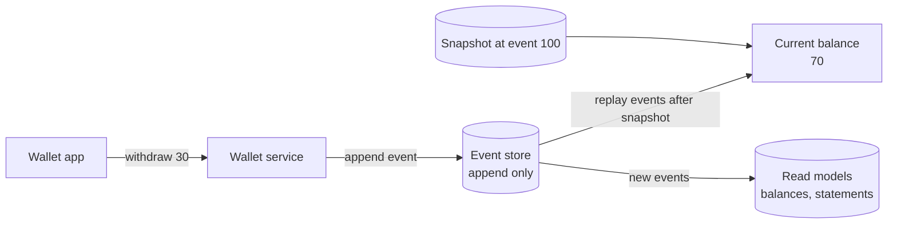

# Event Sourcing

> Event sourcing stores every change as an event in a log that never gets edited, instead of overwriting the current state. You get the current state by replaying the events, so the full history comes for free.

## How it works

A normal database stores the answer: `balance = 70`. Each update overwrites the last one, and the history is gone. Event sourcing stores the steps instead:

1. `AccountOpened`
2. `MoneyDeposited 100`
3. `MoneyWithdrawn 30`

The balance isn't saved anywhere as the truth. You compute it by starting at zero and applying each event in order: 0, then 100, then 70. Events are only ever appended, never changed or deleted. A mistake gets fixed with a new event, like `WithdrawalReversed`, the same way an accountant fixes a ledger.

Replaying 50,000 events on every read would be slow, so you take snapshots. Every 100 events or so, save the computed state along with the event number it covers. To load an account, read the latest snapshot and replay only the events after it.

You rarely query the event log directly. You build read models from it, like a balances table or a statements page, and you can throw one away and rebuild it from the events whenever you like. That's where CQRS usually comes in.

What you get: a full audit trail, answers to "what was the balance on March 3", and new views built from old history. What you pay: more moving parts, and screens that depend on a read model keeping up.

The catch: events are forever. You can't go back and edit a badly designed event, so your code has to read every version of every event you've ever written. Put a version number on events from day one, and don't use event sourcing for parts of the app that are just forms saving settings.

## Example

A wallet app shows a user a balance of $70. She swears it should be $100.

In a system that only stores the current balance, support sees `70` and nothing else. There's no way to tell why.

With event sourcing, support replays her account and spots it right away: `MoneyWithdrawn 30` appears twice, two seconds apart, for the same coffee shop payment. A retry bug wrote the event twice. The team doesn't delete anything. They append `WithdrawalReversed 30`, her balance goes back to $100, and the log still shows exactly what went wrong and when it was fixed.

Then they scan the last month of events for the same pattern and find 41 more accounts with a doubled withdrawal.

## Picture it

Writes only ever append to the event store. The current balance comes from loading the latest snapshot and replaying what happened after it, and the read models are just more views built from the same log.

## Related

[CQRS](cqrs.md) · [Event Streaming](event-streaming.md) · [Write Ahead Log](../08-storage/write-ahead-log.md) · [Materialized Views](../07-databases/materialized-views.md) · [Schema Versioning](../07-databases/schema-versioning.md)
