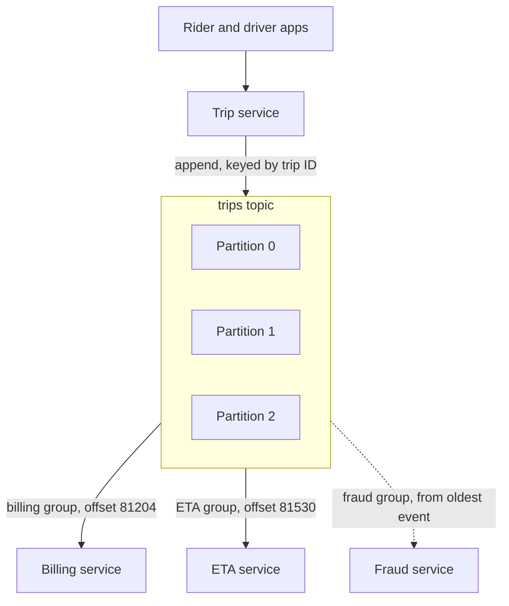

# Event Streaming

> Event streaming keeps every event in a durable, append only log that many readers move through at their own pace. Unlike a queue, reading doesn't delete anything, so you can replay last week whenever you need to.

## How it works

Kafka is the classic example. Producers append events to a topic, and the topic keeps them for a set time, 7 days by default, or forever if you want. A normal queue deletes a message once a worker acks it. A log just grows at the end, and each reader remembers how far it got.

- **Partitions.** A topic is split into partitions, separate logs that can live on different machines. Each event's key, like a trip ID, picks its partition, so all events for one trip stay in order.
- **Offsets.** Every event in a partition has a position number called an offset. A reader is basically a bookmark: "I've processed up to offset 81,204."
- **Consumer groups.** A service reads as a group. Kafka gives each partition to one member, so the members split the work. Another service is another group with its own offsets, reading the same events independently.
- **Replay.** Move a group's offsets back and it reads history again. A brand new service can start from the oldest event.

Order is only guaranteed inside one partition. Two events with different keys can be read in either order.

The tradeoff: you get history, replay, and many readers for the price of one write. You also get a cluster to run, and a partition count that's painful to change later.

Watch out: a partition goes to at most one consumer in a group. A topic with 6 partitions and 10 consumers leaves 4 of them idle, costing money and doing nothing. Partitions cap your parallelism, so pick the count with growth in mind.

## Example

A ride sharing app writes every trip event, like requested, accepted, started, and finished, to a `trips` topic with 12 partitions, keyed by trip ID. Billing and ETA each read it as their own consumer group.

On Tuesday at 14:00 a billing deploy starts using the wrong surge multiplier. The team catches it at 14:40, ships the fix, stops billing, and rewinds its offsets to 13:55:

```bash
kafka-consumer-groups.sh --bootstrap-server kafka:9092 --group billing \
  --topic trips --reset-offsets --to-datetime 2025-08-12T13:55:00.000 --execute
```

Billing rereads 45 minutes of trips and recomputes every fare. Billing saves fares by trip ID, so a recompute overwrites the bad fare instead of adding a second one. ETA never notices, because its offsets didn't move.

A month later the fraud team starts a third group from the oldest retained event and has a week of real trips to work with on day one.

## Picture it



The topic keeps every event. Each consumer group holds its own bookmark into the same log, so billing, ETA, and the late arriving fraud service read the same trips without getting in each other's way.

## Related

[Message Queues](message-queues.md) · [Pub/Sub](pub-sub.md) · [Partitioning](../09-data-at-scale/partitioning.md) · [Event Sourcing](event-sourcing.md) · [Batch vs Stream Processing](batch-vs-stream-processing.md)
