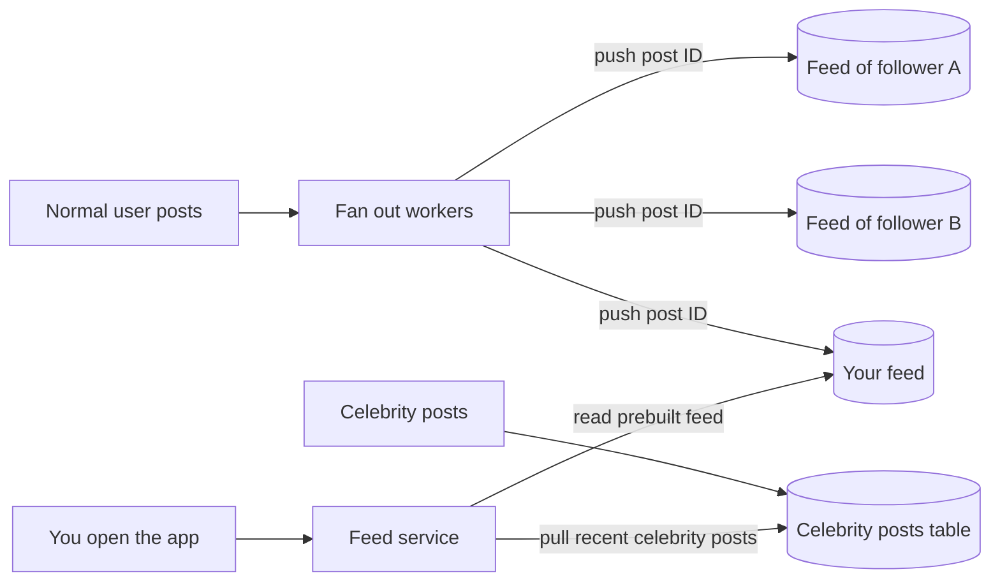

# Fan Out

> Fan out is what happens when one write has to reach many readers, like one post landing in a million feeds. You pay for it either when the post is written or every time a feed is read.

## How it works

Take a social feed. You follow 300 people and want their latest posts, newest first. There are two ways to build that screen.

| | Fan out on write | Fan out on read |
|---|---|---|
| When someone posts | Copy the post ID into every follower's feed | Save the post once |
| When you open the app | Read one prebuilt list | Fetch recent posts from all 300 people and merge |
| Cheap part | Reads | Writes |
| Breaks when | An account has millions of followers | A user follows thousands of accounts |

Most apps get far more reads than writes, so fan out on write usually wins. Each user gets a feed list in a cache like Redis, and background workers push new post IDs into it.

Then a celebrity with 30 million followers posts. That's 30 million cache writes for one post. The workers fall behind, and ordinary posts get stuck in line behind hers.

The fix is a hybrid. Fan out on write for normal accounts. For accounts above a threshold, say 100,000 followers, store the post once and skip the copying. When you open your feed, the server reads your prebuilt list and merges in recent posts from the few celebrities you follow. Twitter described running its home timeline this way.

Watch out: don't fan out inside the request that creates the post. Writing to 5,000 feeds before replying makes posting slow and fragile. Save the post, reply, and let a queue of workers do the copying. Skip followers who haven't opened the app in months, too. Their feed can be built when they come back.

## Example

A social app has 20 million users. A typical user has 200 followers, so a post means 200 small Redis writes, done by workers in well under a second.

Then a pop star with 30 million followers joins. Each of her posts queues 30 million writes. At 500,000 writes a second, that's a full minute of work for one post, and everyone else's posts wait behind it.

The team switches to the hybrid. Accounts over 100,000 followers are flagged as celebrities and never fanned out. When you open the app, the feed service reads your list from Redis, fetches the latest posts from the 6 celebrities you follow, merges them by time, and answers in about 30 ms. The pop star posts and nothing queues up. Normal posts are back to showing up in under a second.

## Picture it

Normal posts get pushed into each follower's feed ahead of time. Celebrity posts are stored once and pulled in only when someone opens the app. The feed service merges the two at read time.

## Related

[Pub/Sub](pub-sub.md) · [Hot Spots](../09-data-at-scale/hot-spots.md) · [Caching](../06-caching/caching.md) · [Message Queues](message-queues.md) · [Normalization vs Denormalization](../07-databases/normalization-vs-denormalization.md)

---

[← Backpressure](backpressure.md) · [All concepts](../../README.md) · [Outbox Pattern →](outbox-pattern.md)
