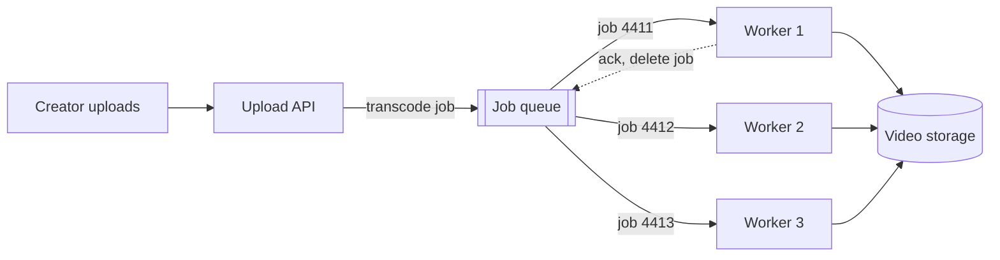

# Message Queues

> A message queue is a waiting line for jobs. Producers drop work in, workers take it out at their own pace, and a traffic spike becomes a longer line instead of an outage.

## How it works

The web server that takes a request doesn't do the slow part. It writes a small message, like "resize photo 812", to a queue such as Amazon SQS or RabbitMQ, and replies right away. A pool of workers pulls messages off the queue and does the real work.

This is point to point: each message goes to exactly one worker. Add more workers and they compete for messages, so throughput goes up without touching the producer. That's why they're called competing consumers.

What makes it safe is the acknowledgment, or ack:

- **Receive.** A worker takes a message. SQS hides it from every other worker for a visibility timeout, 30 seconds by default.
- **Ack.** The job succeeds and the worker deletes the message. Now it's gone for good.
- **No ack.** The worker crashes or the timeout runs out. The message becomes visible again and another worker picks it up.

RabbitMQ has the same idea: a message nobody acked gets redelivered when that worker's connection drops.

The tradeoff: the user gets a fast reply, but the work now happens later. You need a way to show "processing" and to tell the user when a job fails.

The catch: if a job takes longer than the visibility timeout, the message reappears while the first worker is still busy, and a second worker starts the same job. Set the timeout well above your slowest job, and make jobs safe to run twice, because sometimes they will.

## Example

A video streaming site lets creators upload videos. Transcoding a 10 minute video into 4 resolutions takes about 3 minutes.

Before: the upload endpoint transcodes inline. The creator stares at a spinner for 3 minutes, and on a Monday morning when 600 uploads land in one hour, the web servers run out of threads and the whole site slows down.

After: the endpoint saves the file, puts `transcode video 4411` on a queue, and replies in 200 ms. Twenty workers each finish about 20 videos an hour, so 400 an hour in total. The Monday spike leaves a backlog of about 200 jobs, which clears once uploads calm down. The visibility timeout is 10 minutes, well above the 3 minute job. When the backlog stays high for long, you add workers.

## Picture it

The API only drops a job on the queue and replies. Each job goes to exactly one worker, and it's deleted only after that worker acks, so a crashed worker's job goes back in line for someone else.

## Related

[Pub/Sub](pub-sub.md) · [Backpressure](backpressure.md) · [Dead Letter Queues](dead-letter-queues.md) · [Delivery Guarantees](delivery-guarantees.md) · [Autoscaling](../02-scaling/autoscaling.md)

---

[← Garbage Collection](../12-concurrency/garbage-collection.md) · [All concepts](../../README.md) · [Pub/Sub →](pub-sub.md)
