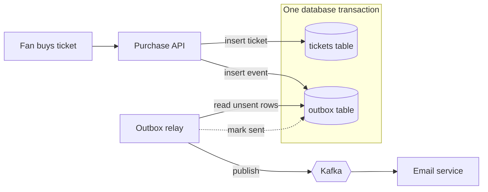

# Outbox Pattern

> The outbox pattern saves an event in the same database transaction as the change that caused it, and a separate relay publishes it later. They commit together, so you never lose an event or send one for a change that never happened.

## How it works

A service often has to do two things together: save a row in its database and publish an event to a broker like Kafka. That's a dual write, and no transaction spans both systems. So one can succeed while the other fails:

- **Saved, not published.** The database commits, then the broker is down or the process crashes. The order exists, but nothing downstream ever hears about it.
- **Published, not saved.** You publish first, then the commit fails. Downstream ships an order that doesn't exist.

The outbox fixes this with one table. In the same transaction that inserts the order, you insert a row into an `outbox` table describing the event. The database commits both or neither, so the promise to publish is exactly as durable as the order.

A relay process then reads unsent outbox rows, publishes each one, and marks it sent. It can poll the table every second, or use change data capture, wich reads new rows straight from the database's change log, like the Postgres write ahead log. Debezium is a common tool for that.

The relay can crash after publishing but before marking the row, so the same event may go out twice. That's at least once delivery, and consumers should dedupe by event ID.

Watch out: calling Kafka from inside your transaction block does not make it part of the transaction. If the commit fails after the publish, the event is already out. The broker call belongs in the relay, never in the request.

## Example

A ticketing site sells 20,000 concert tickets in the first 10 minutes after sales open. The purchase endpoint saves the ticket, then publishes `TicketPurchased` so another service can email the PDF.

During the rush, Kafka is unreachable for 90 seconds. About 3,000 tickets get saved, their publishes fail, and 3,000 fans are charged with no ticket in their inbox. Support spends a week matching payments to email addresses.

With an outbox, the purchase looks like this:

```sql
BEGIN;
INSERT INTO tickets (id, show_id, user_id) VALUES (9812, 77, 501);
INSERT INTO outbox (event_id, type, payload)
  VALUES ('e81f', 'TicketPurchased', '{"ticket_id": 9812}');
COMMIT;
```

When Kafka drops out, the outbox rows just wait. The relay catches up when it's back, and those 3,000 emails arrive up to two minutes late instead of never.

## Picture it



The API never talks to Kafka. It writes the ticket and the event together, so they commit or fail as a pair. The relay is the only thing that publishes, and it keeps retrying for as long as Kafka is down.

## Related

[Delivery Guarantees](delivery-guarantees.md) · [Change Data Capture](../09-data-at-scale/change-data-capture.md) · [ACID Transactions](../07-databases/acid-transactions.md) · [Idempotency](../14-reliability/idempotency.md) · [Distributed Transactions](../11-coordination/distributed-transactions.md)
