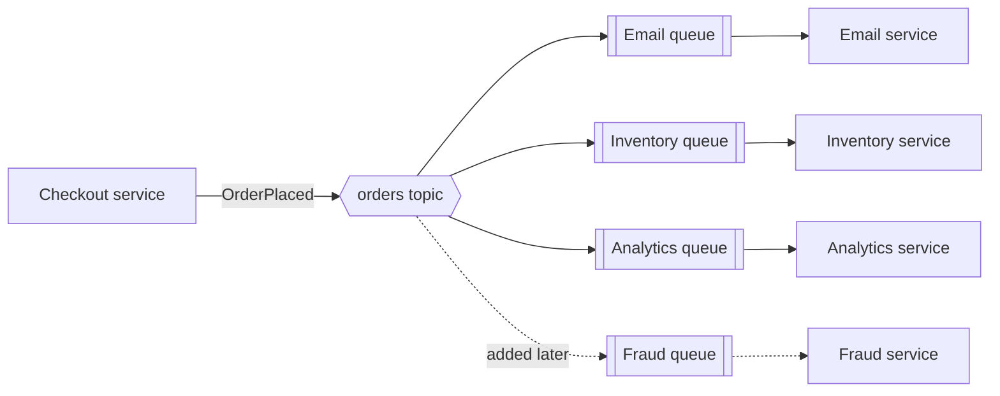

# Pub/Sub

> In pub/sub, a publisher sends a message to a topic, and every subscriber to that topic gets its own copy. The publisher has no idea who is listening, so you can add listeners without touching it.

## How it works

A queue hands each message to one worker. Pub/sub hands each message to everyone who asked for it. The publisher writes "order 5521 placed" to a topic called `orders`. The broker, the server in the middle, copies it to every subscription on that topic.

The publisher doesn't call anyone, doesn't wait for anyone, and doesn't break when a subscriber is down. Subscribers come and go without it knowing. That's the point: one event, many independent reactions.

Brokers differ in what happens when a subscriber isn't there:

- **Fire and forget.** Redis Pub/Sub pushes the message to whoever is connected right now. Nobody connected, nobody gets it.
- **Durable subscriptions.** Google Cloud Pub/Sub keeps unacked messages for each subscription, so a subscriber that was down catches up later.
- **Topic plus queues.** On AWS, an SNS topic can deliver into one SQS queue per subscriber, and each team drains its own queue at its own speed.

Inside one subscriber, you still want the copies to share the work. Three instances of the email service should read from one subscription, not open three, or every customer gets three emails.

The catch: fire and forget is great for live stuff like typing indicators or prices ticking on a screen. It's a bad fit for anything you can't lose. If the email service uses Redis Pub/Sub and restarts during a deploy, every order placed in those 20 seconds gets no confirmation email, and nothing records that it was missed.

## Example

An online store's checkout used to call the email service, the inventory service, and the analytics service, one after another. Each call took about 100 ms, and if analytics was down, checkout threw an error. Customers couldn't buy things because a dashboard was broken.

Now checkout publishes one `OrderPlaced` message to an SNS topic and returns. Three SQS queues subscribe to it, one per service.

One Friday the email service is down for 10 minutes. Its queue quietly fills with 1,200 messages while inventory and analytics carry on. When email comes back, it works through the backlog and every customer gets a receipt, a little late. Next month the fraud team subscribes a fourth queue. Nobody touches the checkout code.

## Picture it

Checkout publishes once and knows nothing about what's downstream. The topic copies the message into a separate queue for each subscriber, so a broken subscriber only backs up its own queue, and a new one plugs in without anyone else changing.

## Related

[Message Queues](message-queues.md) · [Fan Out](fan-out.md) · [Event Driven Architecture](event-driven-architecture.md) · [Event Streaming](event-streaming.md) · [Webhooks](../05-apis/webhooks.md)

---

[← Message Queues](message-queues.md) · [All concepts](../../README.md) · [Event Streaming →](event-streaming.md)
