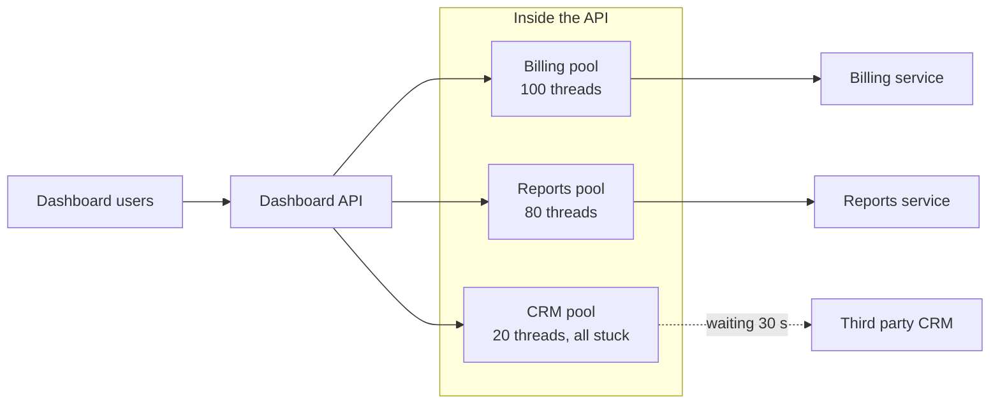

# Bulkheads

> A bulkhead gives each dependency its own small pool of threads or connections. When one dependency gets slow, it can only drown its own pool, and everything else keeps working.



## How it works

The name comes from ships. A hull is split into sealed compartments, so a leak floods one compartment instead of sinking the whole ship.

In software, the leak is a slow dependency. Say your service has one shared pool of 200 threads and calls three things: billing, reports, and a third party CRM. The CRM starts taking 30 seconds per call. Every request that touches it grabs a thread and holds it. A minute later, all 200 threads are waiting on the CRM, and billing requests, which are perfectly healthy, have nowhere to run.

A bulkhead puts a wall between them:

- **Separate pools.** 100 threads for billing, 80 for reports, 20 for the CRM. Each pool fills up on its own.
- **Concurrency caps.** No separate threads, just a counter: at most 20 CRM calls in flight. Call number 21 fails right away instead of waiting.
- **Separate servers.** The heavy version. Run a dedicated set of instances for a risky feature or one huge customer.

When the CRM pool is full, extra CRM calls fail fast, and billing never notices.

The tradeoff is less sharing. If billing suddenly needs 150 threads, it can't borrow the idle CRM ones. Size each pool from real traffic plus some headroom.

The catch: the walls have to go all the way down. Separate thread pools that all share one HTTP connection pool of 20 still let the CRM grab all 20 connections. Split the connection pools too.

## Example

A SaaS dashboard shows billing, usage charts, and contact details pulled from a third party CRM. One morning, the CRM has an outage where calls take 30 seconds before failing.

Before bulkheads, the dashboard API ran on one shared pool. Within a minute, every page was down, including pages that never show CRM data.

After, the CRM gets its own cap of 20 concurrent calls and a 2 second timeout. The next time it slows down, the contacts widget says "Contacts unavailable", and the other 180 threads keep serving billing and charts. Most customers don't notice the outage at all.

```yaml
resilience4j.bulkhead:
  instances:
    crm:
      maxConcurrentCalls: 20
      maxWaitDuration: 10ms
```

## Picture it



The CRM is slow, so all 20 of its threads are stuck waiting. The damage stops at the pool wall. Billing and reports still have their own threads, so those parts of the dashboard load normally.

## Related

[Circuit Breakers](circuit-breakers.md) · [Timeouts](timeouts.md) · [Connection Pooling](../07-databases/connection-pooling.md) · [Multitenancy](../15-architecture/multitenancy.md) · [Graceful Degradation](graceful-degradation.md)

---

[← Circuit Breakers](circuit-breakers.md) · [All concepts](../../README.md) · [Load Shedding →](load-shedding.md)
