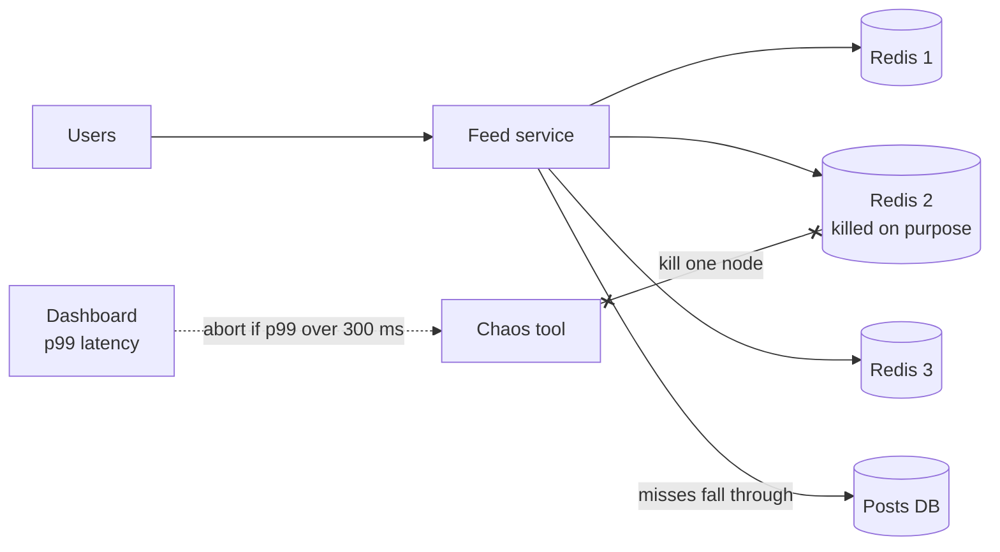

# Chaos Engineering

> Chaos engineering means breaking parts of your system on purpose, while you're watching, to find the weak spots before a real outage finds them for you.

## How it works

Your system is full of failure handling you've never seen run: timeouts, retries, failovers, fallbacks. Chaos engineering tests it by causing real failures in a controlled way.

1. **Define normal.** Pick a number that shows the system is healthy, like orders per minute or p99 latency.
2. **Make a guess.** "If one cache node dies, the feed stays up and p99 stays under 300 ms."
3. **Break something.** Kill a server, add 500 ms of network delay, fill a disk, or block a dependency.
4. **Watch, then stop.** Compare against normal. Either your guess holds, or you just found a bug on your own schedule.

Netflix made this famous with Chaos Monkey, a tool that randomly shuts down servers in production during business hours. Since any server could vanish on any day, teams had to build services that shrug it off. Netflix later released it as open source.

Game days are the scheduled, human version. The team picks a failure, like "at 2 pm we fail over the main database", and watches together. It tests people as much as code. Do the alerts fire? Does the runbook still match reality? Does anyone know who to call?

The catch: blast radius, meaning how much can break if the experiment goes wrong. Start tiny: one server in staging, then a small slice of production traffic, always with a big red stop button. Grow only once the small version is boring. Chaos without monitoring or a way to abort isn't an experiment. It's an outage you caused.

## Example

A social feed service reads from 3 Redis cache nodes. Everyone assumed losing one was fine, since misses just fall through to the database.

On a game day, the team killed one node in staging. The p99 jumped from 120 ms to 9 seconds. The Redis client had no timeout, so every call to the dead node hung until the operating system gave up on the connection.

They added a 50 ms timeout and a circuit breaker per node and ran the same experiment again. This time p99 rose to 180 ms and the feed stayed up. A month later, they ran it in production on one node, and nobody outside the team noticed. They found the bug over coffee on a Tuesday instead of during a 3 a.m. outage.

## Picture it

The chaos tool kills exactly one cache node, which keeps the blast radius small. The dashboard watches p99 the whole time and can stop the experiment the moment the feed gets slow.

## Related

[Production Incidents](../22-operations/production-incidents.md) · [Circuit Breakers](circuit-breakers.md) · [Graceful Degradation](graceful-degradation.md) · [Runbooks](../22-operations/runbooks.md) · [Load Testing](../22-operations/load-testing.md)

---

[← Graceful Shutdown](graceful-shutdown.md) · [All concepts](../../README.md) · [Monolith vs Microservices →](../15-architecture/monolith-vs-microservices.md)
