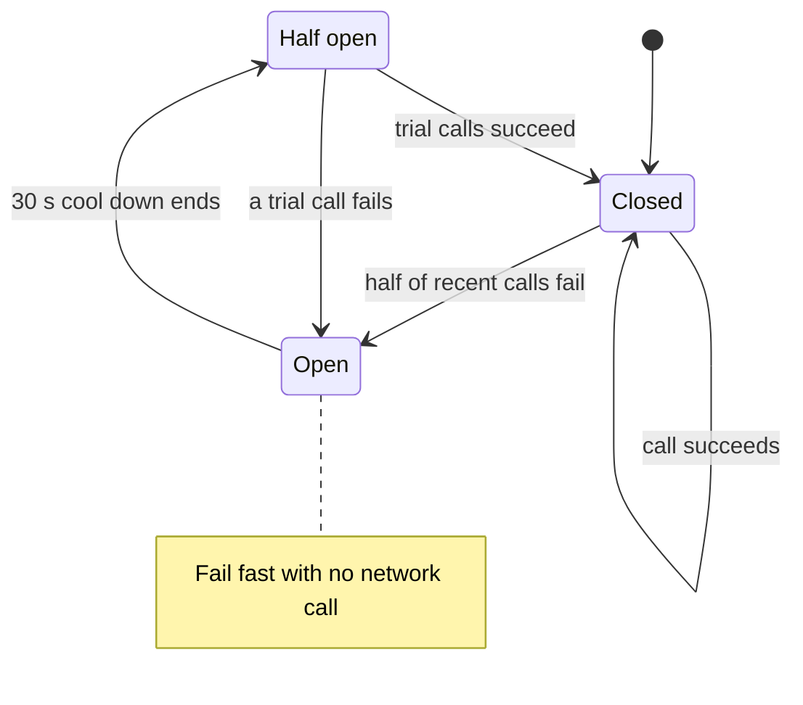

# Circuit Breakers

> A circuit breaker stops calling a dependency that keeps failing and fails fast instead. Your service stays quick, and the broken one gets room to recover.

## How it works

The name comes from the breaker in your home's electrical panel, which cuts the power before the wiring overheats. In software, a breaker wraps every call to one dependency and keeps score. It has three states:

- **Closed.** Normal. Calls go through, and the breaker counts failures and timeouts.
- **Open.** Too many failures, like half of the last 20 calls. The breaker stops calling and returns an error right away, without touching the network.
- **Half open.** After a cool down, like 30 seconds, the breaker lets a few trial calls through. If they work, it closes. If they fail, it opens again for another cool down.

Why bother? Without a breaker, every request waits the full timeout on a dependency that's already dead. At 500 requests a second and a 2 second timeout, that's 1,000 threads stuck waiting at any moment. An open breaker answers in microseconds, frees those threads, and stops piling load on a service that's trying to get back up.

You rarely write this yourself. Libraries like Resilience4j for Java and Polly for .NET let you set the threshold, the cool down, and in Resilience4j, the number of trial calls.

Watch out: an open breaker still needs a plan for the user. If you just throw the error, you've turned slow failures into fast failures, which helps your servers but not your customers. Pair every breaker with a fallback, like a cached answer, a default, or a clear "try again soon".

## Example

A ride sharing app's trip service calls a third party maps API to show "driver arrives in 4 minutes". One evening the maps API goes down, and every call hangs for the full 2 second timeout. The ride request screen slows to a crawl, and threads pile up on the trip service.

With a breaker, enough calls fail within seconds to trip it open. Now those calls fail in under a millisecond, and the app falls back to a rough estimate from straight line distance. Every 30 seconds, the breaker sends a couple of trial calls. When the maps API recovers, the trials succeed, the breaker closes, and real arrival times come back without anyone touching a config.

## Picture it

Start at Closed and follow the failures. Open is where the breaker protects you by refusing to call at all. Half open is the careful test: a few calls decide whether to trust the dependency again.

## Related

[Timeouts](timeouts.md) · [Retries](retries.md) · [Graceful Degradation](graceful-degradation.md) · [Bulkheads](bulkheads.md) · [Fail Fast](../24-principles/fail-fast.md)
