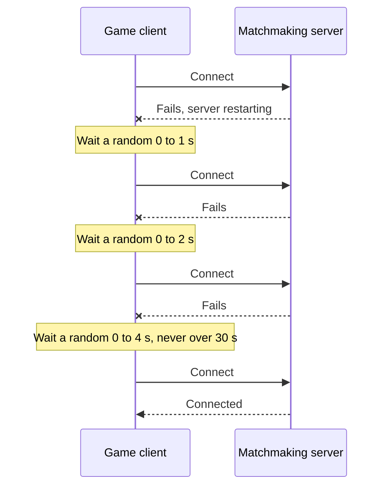

# Exponential Backoff

> Exponential backoff makes each retry wait twice as long as the last. Add a little randomness, and a crowd of failing clients spreads out instead of stampeding a server the moment it comes back.



## How it works

When a call fails, retrying right away is usually pointless. The server that just failed is probably still sick. So you wait, and each time it fails again, you wait longer: 1 second, 2, 4, 8. A struggling server gets fewer and fewer calls from you, which gives it room to recover.

The knobs:

- **Base.** The first wait, like 100 ms or 1 second.
- **Multiplier.** Usually 2. That doubling is the "exponential" part.
- **Cap.** The longest single wait, like 30 seconds. Without it, starting from 1 second, the 16th wait would be over 9 hours.
- **Max attempts.** When to stop and report the error.

Doubling alone has a flaw. Say 10,000 clients all fail in the same second. They all wait exactly 1 second, all retry together, all fail, all wait exactly 2 seconds, and all retry together again. The waves get further apart, but each one is just as big.

Jitter fixes this. Instead of waiting exactly 4 seconds, each client waits a random time between 0 and 4 seconds. This is called full jitter. Every client picks a different moment, so the big waves smear into a steady trickle the server can handle.

The catch: backoff without jitter. It looks right in a unit test with one client, and it falls apart in production with thousands of them, because they all share the same clock.

## Example

A multiplayer game's matchmaking server restarts during the evening peak, with 50,000 players connected. Every game client is coded to reconnect after exactly 1 second.

So the fresh server gets 50,000 connection attempts in the same instant. It falls over. It restarts. A second later, 50,000 attempts again. The outage that should have lasted 20 seconds lasts 15 minutes.

The fix is a few lines in the client. Now the reconnects spread out over the next half minute, the server sees a steady few thousand a second, and players are back in games before most of them notice.

```python
import random, time

def wait_before_retry(attempt, base=1.0, cap=30.0):
    return random.uniform(0, min(cap, base * 2 ** attempt))

for attempt in range(8):
    if connect():
        break
    time.sleep(wait_before_retry(attempt))
```

## Picture it



Each failure doubles the window the client picks its wait from. Because every client picks its own random point in that window, 50,000 of them arrive spread out instead of all at once.

## Related

[Retries](retries.md) · [Rate Limiting](../03-traffic/rate-limiting.md) · [Circuit Breakers](circuit-breakers.md) · [Cache Stampede](../06-caching/cache-stampede.md) · [Load Shedding](load-shedding.md)

---

[← Retries](retries.md) · [All concepts](../../README.md) · [Idempotency →](idempotency.md)
