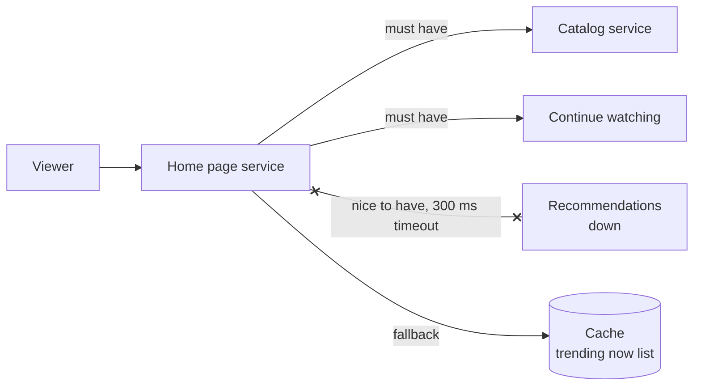

# Graceful Degradation

> Graceful degradation means that when one piece of your system breaks, users get a smaller version of the product instead of an error page. Lose the recommendations, keep the video playing.

## How it works

Most pages are built from many parts, and only a few are truly required. A product page needs the product and the buy button. Reviews, recommendations, and "people also bought" are nice to have. If the reviews service is down, the page should load without reviews, not show a 500.

Start by sorting every dependency into two buckets: must have and nice to have. Then decide, ahead of time, what happens when each nice to have one fails:

- **Hide it.** Drop the recommendations row. Most users won't notice it's gone.
- **Serve stale data.** Show the price or stock count from the cache, even if it's an hour old.
- **Use a default.** Show a generic "Popular now" list instead of a personal one.
- **Go read only.** Turn off comments or uploads, keep everything else working.

To make it automatic, wrap each nice to have call in a short timeout and a circuit breaker, and return the fallback when either one fires.

The tradeoff is accuracy. A cached shoe price from an hour ago is fine. A cached bank balance is not. Decide per feature how stale is too stale.

The catch: fallbacks only run during outages, so they almost never get tested. The first time you need one, it throws its own error, or it quietly calls the same broken service. Break things on purpose in a test to prove each fallback works.

## Example

A video streaming site builds its home page from three services: the catalog, "continue watching", and a recommendations service that runs a heavy model for each viewer.

One evening, recommendations falls over under load. Before, the home page waited on it, timed out after 5 seconds, and showed an error. Viewers couldn't reach any video, even though playback itself was fine.

After, the recommendations call gets a 300 ms timeout. If it fails, the page shows a "Trending now" row that's computed once an hour and kept in cache. "Continue watching" still loads from its own service. Viewers get a slightly less personal home page and keep watching. Most of them never know anything broke.

## Picture it

Recommendations is down, so the home page swaps in the cached trending list. The must have services still answer, and the viewer sees a full page with one row that's less personal.

## Related

[Circuit Breakers](circuit-breakers.md) · [Feature Flags](../20-releases/feature-flags.md) · [Caching](../06-caching/caching.md) · [Load Shedding](load-shedding.md) · [Chaos Engineering](chaos-engineering.md)
