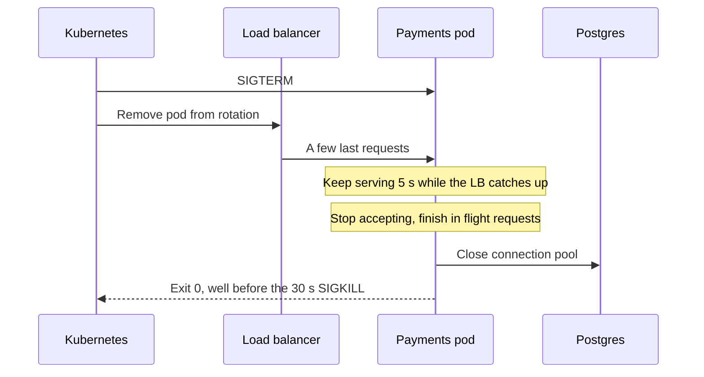

# Graceful Shutdown

> Graceful shutdown means a server that's told to stop first finishes the requests it already started, then exits. Without it, every deploy cuts off whatever was in flight.

## How it works

Servers get stopped all the time: deploys, autoscaling, a machine being drained for maintenance. The polite way to stop a process is the `SIGTERM` signal, which means "please wrap up". If the process is still running after a grace period, it gets `SIGKILL`, which can't be caught or ignored. In Kubernetes, that grace period defaults to 30 seconds.

A graceful shutdown on `SIGTERM` goes like this:

1. **Stop taking new work.** Fail the readiness check and stop accepting new connections.
2. **Finish in flight requests.** Let the ones already running complete, with a deadline shorter than the grace period.
3. **Clean up.** Close database pools, flush logs, commit your place in any queue you read from.
4. **Exit.** With code 0, before `SIGKILL` arrives.

Most frameworks give you the pieces. Go's `http.Server` has `Shutdown`, and Node's `server.close()` stops new connections and waits for open ones. But you have to catch the signal and call them.

Watch out: in Kubernetes, sending `SIGTERM` and removing the pod from the load balancer happen at the same time, not one after the other. For a few seconds after the signal, new requests can still arrive. If you close the socket instantly, they fail. The common fix is to keep serving for 5 to 10 seconds before you drain, with a sleep in the `SIGTERM` handler or a `preStop` sleep, which delays the signal itself.

## Example

A payments API runs 12 pods and deploys 10 times a day. After every deploy, merchants saw a burst of about 30 `502 Bad Gateway` errors. Some were charge requests, and merchants retried them. Idempotency keys kept those retries from double charging anyone, but nobody liked the noise.

The cause: the service had no `SIGTERM` handler, so the process died on the spot and took its in flight requests with it. The fix was a small handler. Wait 5 seconds, stop accepting, give open requests up to 20 seconds, close the Postgres pool, and exit. The 502s after deploys dropped to zero.

```js
process.on("SIGTERM", async () => {
  await sleep(5000);           // let the load balancer catch up
  server.close(async () => {   // no new connections, wait for open ones
    await db.end();            // close the Postgres pool
    process.exit(0);
  });
  setTimeout(() => process.exit(1), 20000).unref();
});
```

## Picture it



The signal and the load balancer update go out together, so a few requests still land after `SIGTERM`. The pod keeps serving briefly, drains what it started, closes its connections, and leaves on its own terms.

## Related

[Liveness and Readiness Probes](liveness-and-readiness-probes.md) · [Rolling Deployments](../20-releases/rolling-deployments.md) · [Idempotency](idempotency.md) · [Kubernetes](../19-build-and-infra/kubernetes.md) · [Autoscaling](../02-scaling/autoscaling.md)
