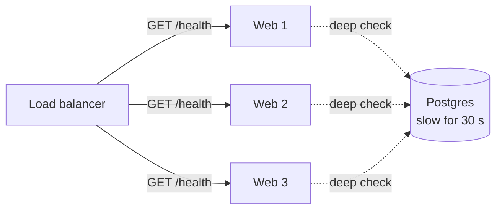

# Health Checks

> A health check is a tiny endpoint, like `/health`, that the load balancer calls every few seconds. If a server stops passing it, the load balancer stops sending that server traffic.

## How it works

The load balancer pings each server on a schedule, say every 5 seconds. A `200` counts as a pass. A timeout or a `500` counts as a failure. After a few failures in a row, like 3, the server is pulled out of rotation. After a few passes in a row, it goes back in. Requiring a streak keeps one slow reply from flipping a server in and out.

There are two styles:

- **Shallow check.** "Is the process up and answering HTTP?" It replies from memory without touching the database or the network. Cheap and fast.
- **Deep check.** It also queries the database, the cache, and maybe other services. It catches more problems, like a server whose database connections all broke.

Deep checks sound better. They're also how you take down your whole site.

The catch: every server shares the same database. If the database has a slow 30 seconds, every server's deep check fails at the same moment. The load balancer pulls all of them out, and now you're serving zero requests instead of slow ones. A small blip became a full outage.

The usual fix: keep the load balancer's check shallow, or make it fail only for problems local to that one server, like a full disk or a jammed worker pool. Report the health of shared dependencies on a separate endpoint that feeds dashboards and alerts, not routing.

Some load balancers have a safety net too. If every target in a group is unhealthy, AWS's Application Load Balancer sends traffic to all of them anyway.

## Example

A news site runs 8 web servers behind a load balancer. Their `/health` endpoint ran a query against Postgres with a 1 second limit.

On election night, traffic tripled and Postgres slowed to 2 seconds per query. Within 15 seconds, all 8 servers had failed 3 checks in a row, and the load balancer removed every one. Readers got errors, even for articles that were cached in memory and never needed Postgres at all.

The fix: `/health` now returns 200 as long as the process is alive and its workers aren't jammed. Postgres status moved to `/health/deps`, which pages the on call engineer but never pulls a server. The next big night, some pages got slow. The site stayed up.

## Picture it

All three health checks lean on the same database. When it slows down, all three fail together, and the load balancer pulls every server at once. That's the deep check trap.

## Related

[Load Balancing](../03-traffic/load-balancing.md) · [Liveness and Readiness Probes](liveness-and-readiness-probes.md) · [Heartbeats](../10-distributed-systems/heartbeats.md) · [Monitoring](../18-observability/monitoring.md) · [Failover](../21-disaster-recovery/failover.md)
