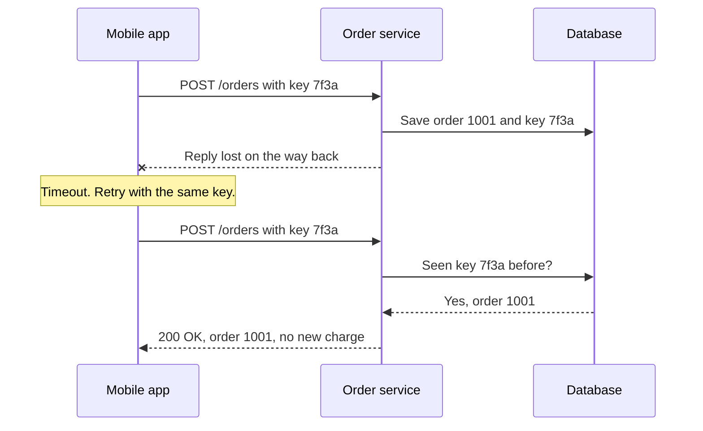

# Idempotency

> An idempotent operation gives the same result whether it runs once or ten times. It is what makes retries safe, so a flaky network never charges a customer twice.



## How it works

Networks fail at the worst moment: after the server did the work, but before the reply got back. The client cannot tell "it failed" apart from "it worked and I never heard". So it retries. If the operation is not idempotent, you just did it twice.

Some operations are safe by nature. `GET /orders/42` only reads. `PUT /users/7` sets a value, and setting the same value twice changes nothing. Deleting something that is already gone is a no op. Others are not safe: `POST /payments` creates a new charge every time, and `balance = balance + 10` adds 10 every time.

To make the risky ones safe, use an idempotency key:

1. The client makes a unique ID for the action and sends it in a header.
2. The server saves the key with the result, in the same transaction as the work.
3. If the same key arrives again, the server skips the work and returns the saved result.

Stripe's payment API works like this, and it can drop a key once it's 24 hours old.

The catch: the check and the work must happen together. If you check the key, then charge, then save the key as three separate steps, two retries that arrive at once can both pass the check. Fix it by saving the key first, in a column with a unique constraint, so the second retry fails before it charges.

## Example

A food delivery app. A user taps "Place order" on a train. The request reaches the server, the card is charged, and then the connection drops before the reply arrives.

The app waits, then retries with the same key. The server finds the key, skips the charge, and sends back the original order. One order, one charge.

Without the key, the retry looks like a brand new order. Two burgers, two charges, one angry customer.

```http
POST /orders
Idempotency-Key: 7f3a9c2e-1b4d-4c8a-9e21-5d0f6a7b8c90
```

## Picture it



The first reply never arrives, so the app retries. Because the retry carries the same key, the server recognizes it and returns the order it already made instead of charging again.

## Related

[Retries](retries.md) · [Timeouts](timeouts.md) · [Exponential Backoff](exponential-backoff.md) · [Delivery Guarantees](../13-messaging/delivery-guarantees.md) · [Outbox Pattern](../13-messaging/outbox-pattern.md)

---

[← Exponential Backoff](exponential-backoff.md) · [All concepts](../../README.md) · [Circuit Breakers →](circuit-breakers.md)
