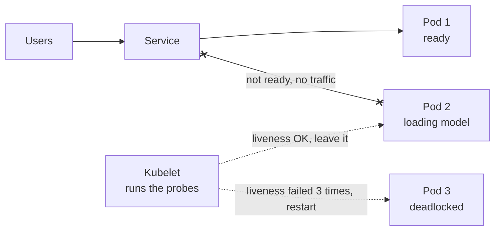

# Liveness and Readiness Probes

> Kubernetes asks every container two different questions: are you stuck, and can you take traffic right now? Failing liveness gets the container restarted, while failing readiness just takes it out of rotation.

## How it works

Kubernetes runs your app as pods, which are running copies of your container spread across many machines. On each machine, an agent called the kubelet calls your probes every few seconds, usually as plain HTTP requests.

- **Liveness probe.** "Is this process alive and making progress?" If it fails a few times in a row, Kubernetes kills the container and starts a fresh one. This rescues a process that's deadlocked or wedged and would never recover by itself.
- **Readiness probe.** "Should this pod get requests right now?" If it fails, Kubernetes removes the pod from the Service, the internal load balancer in front of your pods. Nothing restarts. When the probe passes again, traffic comes back.
- **Startup probe.** For apps that boot slowly. The other two probes wait until this one passes, so a long startup isn't mistaken for a hang.

Readiness is for temporary states: still warming a cache, still loading data, or too busy to take more work for a moment. Liveness is for "this will not get better on its own".

The catch: never check your dependencies in liveness. If the liveness probe queries the database and the database blips, Kubernetes restarts every pod at once. Restarts don't fix a database. They just pile cold starts on top of the outage. Liveness should only check the process itself.

## Example

A photo sharing app has an image tagging service that loads a 3 GB model at startup, which takes about 60 seconds. The team used one `/healthz` endpoint for liveness, returning 503 until the model was loaded.

Liveness started checking after 10 seconds and allowed 3 failures, 10 seconds apart. Each pod got killed at around 30 seconds, restarted, got killed again, and never finished booting.

The fix was to split the endpoint. `/live` answers as soon as the web server is up. `/ready` returns 200 only once the model is loaded. New pods now sit out of traffic for a minute, then join quietly.

```yaml
readinessProbe:
  httpGet:
    path: /ready
    port: 8080
  periodSeconds: 5
livenessProbe:
  httpGet:
    path: /live
    port: 8080
  periodSeconds: 10
  failureThreshold: 3
```

## Picture it



Pod 2 is alive but not ready, so it gets no traffic and no restart. Pod 3 is stuck for good, so the kubelet restarts it. Two questions, two very different reactions.

## Related

[Health Checks](health-checks.md) · [Kubernetes](../19-build-and-infra/kubernetes.md) · [Graceful Shutdown](graceful-shutdown.md) · [Cold Starts](../15-architecture/cold-starts.md) · [Rolling Deployments](../20-releases/rolling-deployments.md)

---

[← Health Checks](health-checks.md) · [All concepts](../../README.md) · [Graceful Shutdown →](graceful-shutdown.md)
