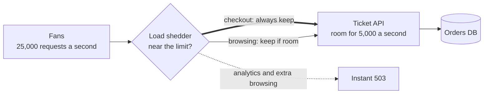

# Load Shedding

> Load shedding is a server dropping some requests on purpose when it gets more than it can handle. Rejecting a fifth of them fast beats serving all of them too slowly to matter.

## How it works

Every server has a ceiling. Past it, requests queue up, each one waits longer, clients time out, and the server ends up doing work for people who already left. Push harder and useful throughput actually drops.

Load shedding says no early. The server watches a signal, like CPU, queue length, or the number of requests in flight. Past a threshold, new requests get a quick `503 Service Unavailable` instead of being started. A rejection costs a millisecond. A request that times out after 10 seconds of work wastes all 10.

Not all requests are equal, so shed by priority:

- **Critical.** Checkout, payments, login. Keep these until the very end.
- **Normal.** Browsing, search, page loads. Shed these when you're near the limit.
- **Background.** Analytics pings, prefetching, batch jobs. Shed these first.

Shed at the front door, in the load balancer or the first bit of middleware, before you parse the body or touch the database. Rejecting a request after doing the work saves nothing.

Rate limiting caps each client, while load shedding protects the server from the total, no matter who is sending.

Watch out for stale work. If a request sat in your queue for 5 seconds and the client gave up after 3, serving it is pure waste. Check how long each request has waited and drop the old ones first. Otherwise the server stays busy finishing requests nobody is waiting for, and the fresh ones time out too.

## Example

A ticketing site puts a big concert on sale at 10:00. The API fleet handles 5,000 requests a second. At 10:00:01, 25,000 arrive.

Without shedding, queues grow, p99 latency climbs to 30 seconds, and checkout times out along with everything else. Fans who already picked seats can't pay. The site is "up" and sells almost nothing.

With shedding, the gateway checks how many requests are in flight. Near the limit, it returns 503 to page refreshes and search first, with a short `Retry-After`. Requests from fans who already hold seats in a cart always go through. Most requests get rejected in a few milliseconds, checkout stays under a second, and the show sells out without the site falling over.

## Picture it

All traffic hits the shedder first. Checkout takes the thick path and always gets through. Browsing gets in only while there's room, and everything else bounces off with a fast 503 before it costs the API anything.

## Related

[Rate Limiting](../03-traffic/rate-limiting.md) · [Backpressure](../13-messaging/backpressure.md) · [Graceful Degradation](graceful-degradation.md) · [Autoscaling](../02-scaling/autoscaling.md) · [Circuit Breakers](circuit-breakers.md)

---

[← Bulkheads](bulkheads.md) · [All concepts](../../README.md) · [Graceful Degradation →](graceful-degradation.md)
