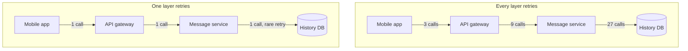

# Retries

> A retry sends a failed call again, betting the failure was a blip. Done right, it hides a flaky network, and done wrong, it turns a small outage into a big one.

## How it works

Lots of failures are temporary. A packet gets dropped, a server restarts, a connection resets. Trying again a moment later usually works, and the user never knows anything happened.

But not every failure deserves a second try:

- **Retry these.** Timeouts, dropped connections, `503 Service Unavailable`, and `429 Too Many Requests` after waiting for the `Retry-After` time. The server might do better next time.
- **Never retry these.** `400 Bad Request`, `401 Unauthorized`, `404 Not Found`, validation errors. The same request will fail the same way forever.
- **Retry only if safe.** Anything that changes data, like a payment, has to be idempotent first, or the retry might do it twice.

Retries also need a limit, usually 2 or 3 extra attempts, and a growing wait between them.

The catch: retries multiply across layers. If the app, the API gateway, and the service behind it each make 3 attempts, one failed tap becomes 3 × 3 × 3 = 27 calls at the bottom. And they arrive exactly when that bottom layer is already struggling. This is a retry storm, and it can keep a service down long after the original problem is gone.

Two fixes. First, retry in one layer only, and let the others fail fast. Second, use a retry budget: retries may be at most, say, 10% of a service's traffic. When the budget is spent, failures go straight back to the caller. A blip still gets retried. A real outage doesn't get tripled.

## Example

A chat app's message history database has a slow minute. Normally it handles 2,000 queries a second.

The mobile app tries 3 times. So does the API gateway. So does the message service. At the database, 2,000 queries a second becomes up to 54,000. A database that needed one minute to recover is now buried, and history stays broken for half an hour.

The fix: the app and the gateway stop retrying on their own. Only the message service retries, with backoff, and with a 10% budget. In the next slow minute, the database sees at most about 2,200 queries a second and recovers on its own.

## Picture it

Follow one failed tap down each column. Where every layer retries, the calls triple at each hop, and the database takes 27 hits. Where only the message service retries, with a 10% budget, the database barely feels it.

## Related

[Exponential Backoff](exponential-backoff.md) · [Idempotency](idempotency.md) · [Timeouts](timeouts.md) · [Circuit Breakers](circuit-breakers.md) · [Backpressure](../13-messaging/backpressure.md)

---

[← Timeouts](timeouts.md) · [All concepts](../../README.md) · [Exponential Backoff →](exponential-backoff.md)
