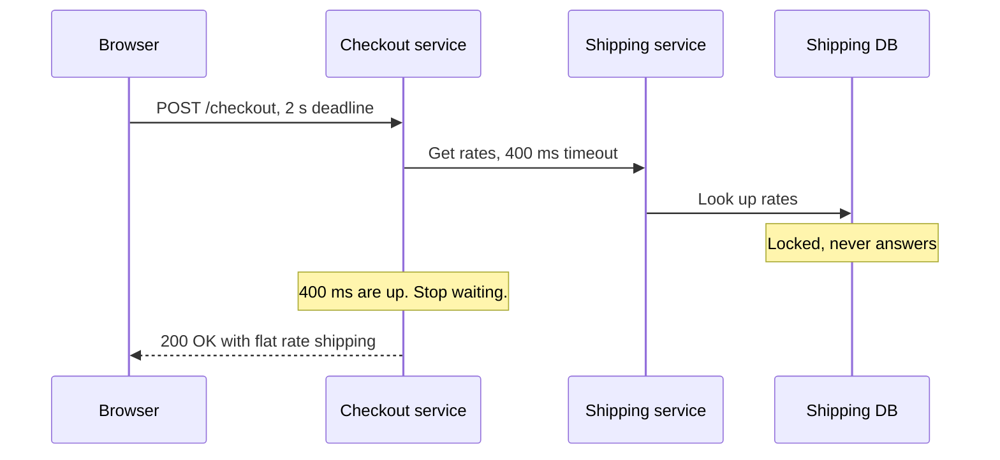

# Timeouts

> A timeout is how long you are willing to wait for a reply before giving up. Without one, a single slow dependency can freeze every request that touches it.

## How it works

Every network call can hang. The server on the other end might be overloaded, crashed, or stuck on a lock. If you never give up, your thread waits, and so does your user. A timeout says: wait this long, then fail and move on.

The scary part is the default. Python's `requests` library and Go's default HTTP client both have no timeout on the reply unless you add one. A hung server can hold that call forever, so "we never set one" really means "we chose infinity".

There are three kinds:

- **Connect timeout.** How long to wait to open the connection. Keep it short, since a healthy server accepts in milliseconds.
- **Read timeout.** How long to wait for the reply once connected.
- **Deadline.** A cap on the whole request, retries included.

To pick a value, look at the dependency's p99 latency, the time 99 out of 100 calls finish under. If that's 150 ms, a 400 ms timeout gives slow calls room and still cuts off the truly stuck ones. Too tight and you fail healthy calls. Too loose and you wait on dead ones.

In a chain of services, pass the deadline down. The user's request gets 2 seconds, and each call tells the next service how much time is left. A service that gets a request with 30 ms left can skip it instead of doing work nobody will read. gRPC has this built in.

The catch: timeouts that don't shrink as you go deeper. If the front end gives up after 2 seconds but the service behind it waits 10 seconds on the database, the database keeps grinding for a user who already left.

## Example

An online store's checkout calls a shipping rates service. It usually answers in 80 ms. One Friday, the shipping database locks up and calls stop returning.

The checkout service had no timeout. Each checkout grabbed one of its 200 worker threads and waited. Within a minute, all 200 were stuck, and nobody could check out, even shoppers who picked in store pickup and never needed a shipping rate.

The fix was two numbers and a fallback. Wait 100 ms to connect and 400 ms for a reply, and if that fails, charge a flat shipping rate. The next time the shipping database locked up, checkout just got a little less precise.

```python
rates = requests.get(SHIPPING_URL, params=cart, timeout=(0.1, 0.4))
```

## Picture it



The shipping database never answers, but checkout only waits 400 ms. The thread is freed, the shopper still gets an order, and the 2 second deadline on the whole request is never at risk.

## Related

[Retries](retries.md) · [Circuit Breakers](circuit-breakers.md) · [P99 Latency](../01-performance/p99-latency.md) · [Bulkheads](bulkheads.md) · [Graceful Degradation](graceful-degradation.md)
