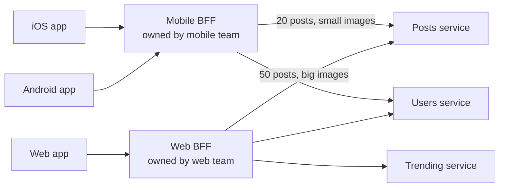

# Backend for Frontend

> A backend for frontend gives each kind of client, like the mobile app and the web app, its own small backend that shapes data for its screens. The team that builds the client owns it.

## How it works

Picture one general purpose API serving every client. The phone wants 20 posts with small images. The web app wants 50 posts, big images, and a sidebar. The TV app wants something else again. Every screen either downloads too much or makes 6 calls over a slow mobile network, and every change to the shared API needs every client team to agree.

A backend for frontend, or BFF, gives each kind of client its own thin backend. The mobile BFF calls the posts, users, and media services in parallel over the fast internal network, trims the results, and returns exactly what one phone screen needs, in one response. The web BFF does the same job for the web.

Ownership is the point. The team that builds the client also owns its BFF, so they can change a screen and the API behind it in one release, without waiting on anyone. A rule of thumb Sam Newman credits to Stewart Gleadow is "one experience, one BFF". iOS and Android apps that look alike and belong to one team can share one.

The pattern came out of SoundCloud around 2013, where every app had been talking to one public API. Sam Newman's 2015 write up spread the name.

A BFF should stay thin. It gathers and shapes data, and the business rules stay in the services behind it.

The catch: duplicated logic. Three BFFs that each merge user, follower, and avatar data into a "profile" hold three copies of the same code, with three slightly different bugs. At SoundCloud, that duplication turned out to be a missing service, and they built a shared user profile service for the BFFs to call.

## Example

A social feed has a web app, an iOS app, and an Android app, all calling one REST API. To draw the home screen, the phone makes 5 calls: feed, authors, like counts, comments, and ads. On a mobile connection with 150 ms round trips, that's most of a second before anything appears, and half the JSON is fields only the web app uses.

The mobile team builds a mobile BFF. The app makes one call, `GET /home`. The BFF calls the 5 services in parallel inside the data center, where each hop takes a couple of milliseconds, and returns 20 posts with small thumbnails and only the fields the phone shows. The response shrinks from 400 KB to 60 KB, and the screen paints about half a second sooner.

The web team runs its own BFF, with 50 posts and a trending sidebar. When the mobile team redesigns the home screen, they ship the app and its BFF together, and nobody from the web team has to join the meeting.

## Picture it

Both BFFs call the same services underneath. What differs is the shape of the answer each one builds, and which team gets to change it.

## Related

[API Gateways](../03-traffic/api-gateways.md) · [GraphQL](../05-apis/graphql.md) · [Monolith vs Microservices](monolith-vs-microservices.md) · [Domain Driven Design](domain-driven-design.md) · [DRY](../24-principles/dry.md)

---

[← Service Mesh](service-mesh.md) · [All concepts](../../README.md) · [Strangler Fig →](strangler-fig.md)
