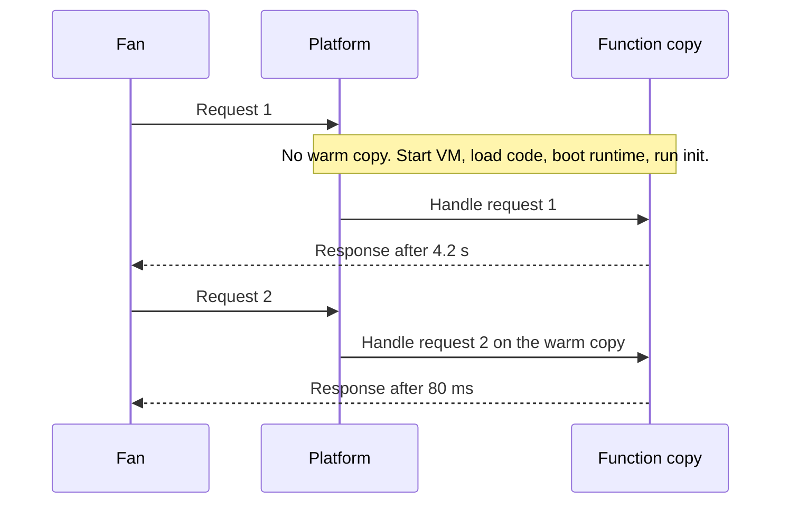

# Cold Starts

> A cold start is the extra wait when a serverless platform has to boot a fresh copy of your function before it can answer. It adds anywhere from under 100 milliseconds to several seconds, usually right when traffic spikes.

## How it works

When a request arrives and no warm copy of your function is free, the platform builds one. It finds a machine, starts a tiny isolated VM or container, downloads your code, boots the language runtime, and runs your startup code: imports, config loading, database clients. Only then does your handler run. The next request on that copy skips all of it. That is a warm start.

Idle copies get shut down after a while, and whenever traffic grows faster than the warm pool, new copies start cold. What makes it worse:

- **Big bundles.** A 200 MB package with every SDK takes far longer to download and load than a 2 MB one.
- **Heavy runtimes.** A JVM or .NET runtime boots much slower than Node, Python, or Go.
- **Startup work.** Fetching secrets, filling caches, and opening connections at boot all land on that first request.
- **Network setup.** Putting a Lambda function inside a private network (a VPC) used to add whole seconds, until AWS reworked it in 2019. Anything the platform has to wire up per copy shows up here.

The fixes: keep functions small, and load rarely used code only when you need it. Use provisioned concurrency, where the platform keeps a set number of copies booted and ready, for a fee. On Lambda, SnapStart goes further and restores a memory snapshot of an already initialized copy instead of booting one from scratch.

Watch out: the classic trick of pinging the function every 5 minutes keeps exactly one copy warm. A burst of 50 requests at once still needs 49 more copies, and all 49 start cold.

## Example

A ticketing site sells concert tickets through a Java function on Lambda. Most of the day, 5 copies handle everything. At 10:00 sharp a big tour goes on sale, and requests jump to 400 at once.

Each new copy needs 4 seconds to boot the JVM and load an 80 MB bundle. So 395 fans stare at a spinner for 4 seconds, and many hit refresh, which makes it worse.

The fix has two parts. Provisioned concurrency of 400 is scheduled from 9:45 to 10:30, so the copies are booted before the doors open. The bundle drops to 15 MB after removing SDKs nobody used, so the few copies that still start cold boot in about a second.

## Picture it

The first request pays for the whole boot sequence in the note. The second lands on the same copy, now warm, and comes back in 80 ms.

## Related

[Serverless Limits](serverless-limits.md) · [Autoscaling](../02-scaling/autoscaling.md) · [Tail Latency](../01-performance/tail-latency.md) · [Latency](../01-performance/latency.md)

---

[← Serverless Limits](serverless-limits.md) · [All concepts](../../README.md) · [Authentication vs Authorization →](../16-identity-and-encryption/authentication-vs-authorization.md)
