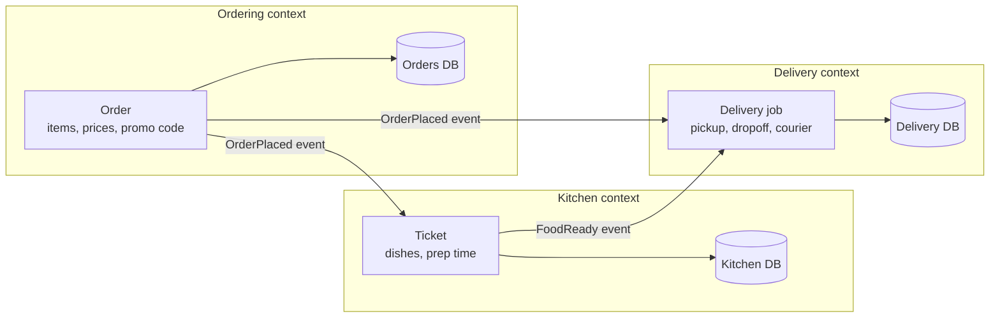

# Domain Driven Design

> Domain driven design builds software around how the business actually talks and works. Its big idea, bounded contexts, splits a large system into areas with their own language and model, and those areas make good service boundaries.

## How it works

DDD starts from a plain observation: in most business software, the hard part is the business, not the code. So engineers work closely with domain experts, the people who actually run dispatch or billing, and shape the software around how those people think. Eric Evans laid it out in his 2003 book of the same name.

Two ideas do most of the work:

- **Ubiquitous language.** One shared vocabulary, used the same way in meetings, docs, and code. If the kitchen staff say "ticket", the class is called `Ticket`, not `OrderPrepRecord`.
- **Bounded contexts.** A big business doesn't have one meaning per word. To sales, a "customer" is a lead with a deal size. To support, it's someone with open tickets. A bounded context is a boundary inside which one model and one language hold. Across boundaries, the same word can mean something else, and you translate at the edge.

Inside a context, DDD has more patterns, like the aggregate: a cluster of objects that always changes together as one unit. For system design, though, the boundaries matter most, because they're a good guide to service boundaries. A bounded context owns its data and its rules, so it's a natural candidate for one service, or one module inside a monolith. Teams that split by noun instead, one customer service and one order service shared by everyone, end up with services that always have to change together.

The catch: DDD was built for complex domains. On a simple CRUD app, one that mostly creates, reads, updates, and deletes rows, weeks of modeling workshops and careful aggregate design buy nothing a few clean modules wouldn't. Use the shared language and the boundaries anywhere, and save the heavy machinery for the tangled core of the business.

## Example

A food delivery app has one `Order` class with 60 fields. The ordering team adds promo codes, the kitchen team adds prep times, the delivery team adds courier routes, and every change breaks someone else's tests.

The teams sit down with people from each part of the business and find three contexts using one word for three things. To ordering, an order is items, prices, and a promo code. To the kitchen, it's a ticket with dishes and a prep time. To delivery, it's a job with a pickup, a dropoff, and a courier.

Each context gets its own model, its own tables, and later its own service. They share an order ID and talk through events. Ordering publishes `OrderPlaced`, the kitchen turns it into a ticket, and delivery turns it into a job. When the kitchen adds a rush flag, nobody else's code changes.

## Picture it

The same real order shows up three times, with a different shape and name in each context. Each context keeps only the fields it cares about, owns its own data, and hears about the others through events.

## Related

[Monolith vs Microservices](monolith-vs-microservices.md) · [Conway's Law](../23-laws/conways-law.md) · [Event Driven Architecture](../13-messaging/event-driven-architecture.md) · [Coupling and Cohesion](../24-principles/coupling-and-cohesion.md) · [Strangler Fig](strangler-fig.md)

---

[← Monolith vs Microservices](monolith-vs-microservices.md) · [All concepts](../../README.md) · [Service Discovery →](service-discovery.md)
