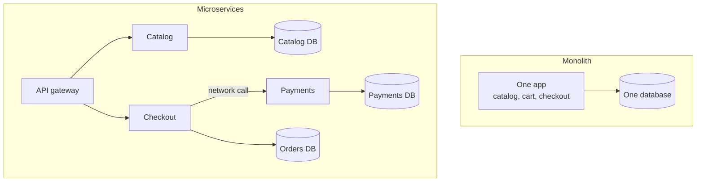

# Monolith vs Microservices

> A monolith is one app you build and deploy as a single unit. Microservices split it into many small services that ship on their own, which buys team independence and costs you network calls, operations work, and data headaches.

## How it works

In a monolith, the checkout code calls the inventory code with a plain function call. It takes nanoseconds and never gets lost. Everything shares one database, so a single transaction can update the order and the stock count together. One build, one deploy, one thing to watch.

Microservices draw lines around business areas: orders, payments, users, search. Each one runs as its own process, owns its own data, and talks to the others over the network. What you gain:

- **Independent deploys.** The search team ships 10 times a day without waiting on payments.
- **Independent scaling.** Run 40 copies of search and 3 of billing.
- **Fault isolation.** A memory leak in recommendations does not take down checkout.

What you pay: every function call becomes a network call that can be slow or fail, so you need timeouts, retries, and tracing. Joins across services are gone. A transaction that spans orders and payments turns into a multi step workflow with undo logic. And you now run 20 pipelines, 20 dashboards, and 20 on call rotations.

That is why the usual advice is to start with a monolith. Early on you do not know where the right boundaries are. Moving a line inside one codebase is a refactor, and moving it between services is a migration. Keep the monolith modular, then split off a piece when a team or a scaling need forces it.

The catch: services that share one database, or that must deploy together, are a distributed monolith. You pay every microservice cost and get none of the independence.

## Example

An online store has 6 engineers and one Rails app. After a conference talk, they split it into 12 services. Six months later, a product page fans out to 7 services, the slowest 1% of page loads went from 180 ms to 900 ms, and a pricing fix needs 3 services deployed together because they all read the same `products` table.

They merge back into one app with clear modules: catalog, cart, checkout, payments. Two years later the company has 60 engineers, and checkout traffic jumps 20 times on sale days. Now they pull checkout out as its own service, with its own database and a clear API. One service split off for a real reason beats twelve split off for fashion.

## Picture it

In the monolith, every module talks in memory and shares one database. In the microservices version, each service owns its data, and every arrow between services is a network call that can be slow or fail.

## Related

[Service Discovery](service-discovery.md) · [Strangler Fig](strangler-fig.md) · [Saga Pattern](../11-coordination/saga-pattern.md) · [Distributed Tracing](../18-observability/distributed-tracing.md) · [Conway's Law](../23-laws/conways-law.md)

---

[← Chaos Engineering](../14-reliability/chaos-engineering.md) · [All concepts](../../README.md) · [Domain Driven Design →](domain-driven-design.md)
