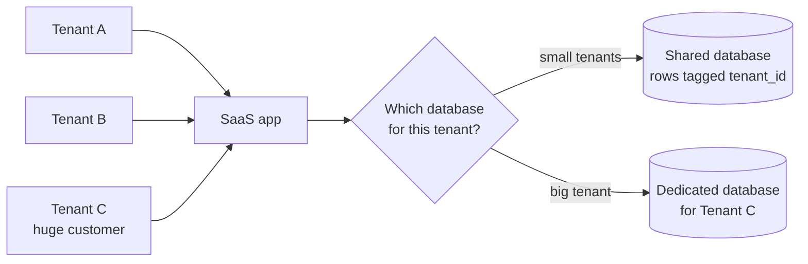

# Multitenancy

> Multitenancy means many customers, called tenants, share the same app and infrastructure. It keeps costs low, and it makes two things your problem: one tenant slowing everyone down, and one tenant seeing another's data.

## How it works

Every SaaS product has to decide how separate each customer's data is. There are three classic models:

| Model | Isolation | Cost and effort |
|---|---|---|
| Shared tables, `tenant_id` on every row | Weakest, one bad query leaks | Cheapest, one schema to migrate |
| Schema per tenant, one database | Medium | Every migration runs once per schema |
| Database per tenant | Strongest, easy to move or delete one customer | Priciest, 5,000 databases to patch |

Many teams mix them. Small customers share tables, and the few giant ones get a database of their own.

Sharing brings two problems. The first is the noisy neighbor: one tenant runs a huge export, hogs the CPU, and 300 other customers see slow pages. Fixes include per tenant rate limits, query timeouts, and moving the heavy tenant somewhere else.

The second is the leak. With shared tables, every single query needs `WHERE tenant_id = ?`. Write 2,000 queries and you will forget one, and that one query shows customer A the invoices of customer B.

The catch: relying on developers to remember the filter. Put it where nobody can skip it. A data access layer can add it to every query automatically, and Postgres row level security can make the database itself refuse to return another tenant's rows. Take the tenant ID from the logged in session, never from a request field the client controls.

## Example

A SaaS dashboard serves 2,000 companies from one Postgres cluster with shared tables. At 9 am on Monday, one enterprise customer with 40 million events starts a year long report. CPU hits 100%, and dashboards for the other 1,999 companies take 12 seconds to load.

Short term, the team adds a 30 second query timeout and a limit of 2 running reports per tenant. Long term, every tenant with more than 10 million events moves to a dedicated database. A small routing table maps each tenant ID to its database, so the app code never cares where a tenant lives. The big customer gets faster reports, and the small ones stop feeling it.

## Picture it

Small tenants share one database and are kept apart by a tenant ID on every row. The giant customer gets its own database, so its heavy reports cannot slow down anyone else.

## Related

[Sharding](../09-data-at-scale/sharding.md) · [Rate Limiting](../03-traffic/rate-limiting.md) · [Bulkheads](../14-reliability/bulkheads.md) · [Authentication vs Authorization](../16-identity-and-encryption/authentication-vs-authorization.md) · [Hot Spots](../09-data-at-scale/hot-spots.md)

---

[← Strangler Fig](strangler-fig.md) · [All concepts](../../README.md) · [Serverless Limits →](serverless-limits.md)
