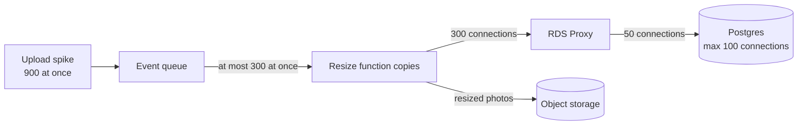

# Serverless Limits

> Serverless functions run your code on demand and bill by the millisecond, with no servers to manage. The trade is a set of hard limits on run time, memory, payload size, and concurrency that you have to design around.

## How it works

You upload a function, say `resizePhoto`. The platform runs it when an event arrives, like an HTTP request or a file upload, and starts as many copies as traffic needs. No traffic, no bill. AWS Lambda, Azure Functions, and Cloudflare Workers all work roughly this way.

The limits, with AWS Lambda numbers:

- **Max run time.** 15 minutes per call, then the platform kills it. Long video encodes do not fit.
- **Memory.** 128 MB to 10 GB, and the CPU you get grows with the memory you pick.
- **Payload size.** 6 MB for a synchronous request or response. Big files go through object storage, not through the function call.
- **Concurrency.** 1,000 copies running at once per region by default, shared by every function in the account. One runaway function can starve the rest.
- **No local state.** Each call may land on a fresh copy. Memory and the `/tmp` disk might survive to the next call, or might not, so anything that matters goes in a database or cache.

The catch: database connections. A normal server keeps a pool of maybe 20 connections and shares it across requests. Serverless copies share nothing, so each one opens its own. A burst to 800 copies means 800 connections, and Postgres allows 100 by default. Put a connection pooler like RDS Proxy or PgBouncer in between, and cap the function's concurrency so a spike cannot flatten the database.

## Example

A photo sharing app runs a function on every upload: resize the photo, then insert a row into Postgres. Normal traffic needs about 20 copies at once. Then a celebrity starts a photo challenge, and uploads jump to 900 at once.

Lambda happily scales to 900 copies. Postgres, with `max_connections` set to 100, starts refusing them with "sorry, too many clients already", and the whole app goes down, not just uploads.

The fix takes an afternoon. RDS Proxy sits in front of Postgres and funnels all those function connections into 50 real ones. Reserved concurrency caps the resize function at 300 copies, so extra upload events wait in the queue and get processed a little later. The database never sees more than it can handle.

## Picture it

The concurrency cap and the proxy act as two funnels. Only 300 copies run at once, and their 300 connections squeeze into 50 real ones, well under the 100 that Postgres allows.

## Related

[Cold Starts](cold-starts.md) · [Connection Pooling](../07-databases/connection-pooling.md) · [Stateless Services](../02-scaling/stateless-services.md) · [Object Storage](../08-storage/object-storage.md) · [Message Queues](../13-messaging/message-queues.md)

---

[← Multitenancy](multitenancy.md) · [All concepts](../../README.md) · [Cold Starts →](cold-starts.md)
