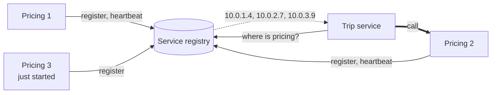

# Service Discovery

> Service discovery is how one service finds the current addresses of another. When instances start, die, and move every few minutes, hard coded IP addresses stop working on day one.

## How it works

Your orders service needs to call payments. Payments runs on 5 instances today, 9 tomorrow, and any one of them can be replaced at 3 am with a new IP address. A config file full of addresses does not survive the first deploy.

The fix is a registry: a small, always on database of who is running where. Consul, etcd, ZooKeeper, and Netflix's Eureka are common ones. When an instance starts, it registers its address. While it is alive, it keeps sending heartbeats or passing health checks. When it goes quiet, the registry drops it.

There are a few ways to use the registry:

- **Client side discovery.** The caller asks the registry for the list of payments instances, picks one, and calls it directly. Fast and flexible, but every client needs a discovery library in its language.
- **Server side discovery.** The caller sends traffic to one stable address, like a load balancer, and the load balancer looks up healthy instances. Clients stay simple.
- **DNS.** The registry answers DNS queries, so `payments.internal` resolves to live instances. Kubernetes works this way: every service gets a stable DNS name and a virtual IP that forwards to its healthy copies.

Watch out: DNS answers get cached. If a client holds on to an IP for 5 minutes, it keeps calling an instance that died 4 minutes ago. Keep the DNS time to live short, and check that your HTTP client actually respects it. Long lived connections have the same problem, so close and reopen them every few minutes.

## Example

A ride sharing app runs its pricing service on 3 instances. Friday at 6 pm, autoscaling adds 7 more. The trip service still has the old 3 addresses in its config, so those 3 melt while 7 fresh ones sit idle. Then one of the original 3 gets replaced, and 1 in 3 price quotes starts failing.

With a registry, each pricing instance registers itself on boot and sends a heartbeat every 10 seconds. The trip service asks the registry who is serving pricing right now, and spreads calls across all 10. An instance that misses 3 heartbeats is gone from the list within 30 seconds. Nobody edits a config file.

## Picture it

Every instance tells the registry it exists and keeps proving it is alive. The trip service asks for the current list, then calls one instance directly. That is client side discovery.

## Related

[Load Balancing](../03-traffic/load-balancing.md) · [DNS](../04-networking/dns.md) · [Health Checks](../14-reliability/health-checks.md) · [Heartbeats](../10-distributed-systems/heartbeats.md) · [Service Mesh](service-mesh.md)

---

[← Domain Driven Design](domain-driven-design.md) · [All concepts](../../README.md) · [Service Mesh →](service-mesh.md)
