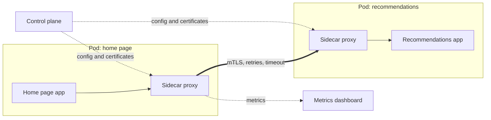

# Service Mesh

> A service mesh puts a small proxy next to every service and sends all traffic through it. Retries, encryption, and traffic metrics happen in the proxy, so every team gets them without changing a line of code.

## How it works

Once you have 40 services in 4 languages, every team writes its own retry logic, its own TLS setup, and its own metrics. Some get it right. A mesh moves that work out of the app and into infrastructure.

Each service instance gets a sidecar: a proxy process running right next to it, in the same Kubernetes pod. Network rules route every request in and out of the app through that proxy. The app thinks it is calling `http://inventory`, and the sidecar does the real work. Istio uses the Envoy proxy for this. Linkerd uses its own small proxy written in Rust.

The sidecars are called the data plane. A control plane pushes config to all of them and hands out certificates. Together they give you:

- **Retries and timeouts.** Set once in config, applied to every call.
- **mTLS.** Mutual TLS, where both sides prove who they are with certificates and the traffic is encrypted. The mesh rotates the certificates for you.
- **Metrics.** Request rate, error rate, and latency for every pair of services, with no instrumentation code.
- **Traffic shifting.** Send 5% of calls to a new version for a canary release.

The price is real. Every call now passes through two extra proxies, which adds latency, and every sidecar eats memory and CPU. Debugging gets one more layer. Istio's newer ambient mode drops the sidecar in each pod for shared proxies, one per node plus optional ones for features like retries, partly to cut that cost.

Watch out: retries stack. If the app makes 3 attempts and the mesh makes 3 attempts for each one, a single failing call turns into 9 requests against a service that is already struggling. Pick one layer to own retries.

## Example

A video streaming site has 40 services. The recommendations service starts timing out under load. Some callers retry forever, some never retry, and nobody can say who is hammering it, because only half the services export metrics.

They roll out Istio. Within a day, every pair of services has a dashboard with success rate and latency, and the culprit turns out to be the home page service, retrying in a tight loop. Retries and timeouts move into one config, and all traffic between services is now encrypted. No application code changed.

```yaml
apiVersion: networking.istio.io/v1
kind: VirtualService
metadata: {name: recommendations}
spec:
  hosts: [recommendations]
  http:
  - route: [{destination: {host: recommendations}}]
    timeout: 2s
    retries: {attempts: 2, perTryTimeout: 1s}
```

## Picture it



The two apps never talk to each other directly. Their sidecars do, over an encrypted connection, while the control plane hands both proxies their rules and certificates.

## Related

[Service Discovery](service-discovery.md) · [Retries](../14-reliability/retries.md) · [Encryption in Transit](../16-identity-and-encryption/encryption-in-transit.md) · [Canary Releases](../20-releases/canary-releases.md) · [Kubernetes](../19-build-and-infra/kubernetes.md)

---

[← Service Discovery](service-discovery.md) · [All concepts](../../README.md) · [Backend for Frontend →](backend-for-frontend.md)
