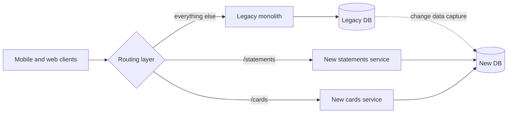

# Strangler Fig

> The strangler fig pattern replaces a legacy system one piece at a time. A routing layer sends each feature to the new code once it is ready, and the old system shrinks until you can switch it off.

## How it works

Martin Fowler named it after a fig that grows around a host tree until it stands on its own, and the tree inside often dies. The alternative is the big bang rewrite: rebuild everything, then switch over on one scary weekend. Those projects tend to run years late, because the old system keeps changing and nobody remembers every rule buried in it.

The strangler fig goes in small steps:

1. **Put a router in front.** A proxy or API gateway that, at first, sends every request to the legacy system.
2. **Build one slice new.** Pick a small, well understood feature, like account statements.
3. **Flip the route.** Send `/statements` to the new service. Keep the old route ready so you can flip back in seconds.
4. **Repeat.** Move slice after slice until the legacy system handles nothing, then turn it off.

The hard part is data. For months, both systems need the same customer records. Usually the legacy database stays the source of truth at first, and change data capture, which streams every row change out of a database, copies updates into the new one. Later, you reverse the direction.

The catch: stopping at 80%. The easy slices move fast, the gnarly ones get postponed, and three years later you run the old system and the new one, with double the on call load. Plan the ending too, including the date the old system goes dark.

## Example

A bank runs a 15 year old Java monolith for online banking. A full rewrite was estimated at 3 years with features frozen the whole time, and nobody would approve that.

Instead, the team puts an API gateway in front. The first slice is statements, which are read only and easy to check. For two weeks, the gateway sends each statement request to both systems and compares the answers, while customers still see the old one. Once the outputs match on 99.9% of requests and the gaps are fixed, `/statements` flips to the new service.

Next come card controls, then payees, with transfers, the scariest one, last. After 18 months the monolith serves only login, and login is the next card on the board.

## Picture it

Clients only ever talk to the routing layer, so they never notice the migration. Each new route takes a slice away from the monolith, and the dotted arrow keeps the new database in sync until the old one is retired.

## Related

[Monolith vs Microservices](monolith-vs-microservices.md) · [API Gateways](../03-traffic/api-gateways.md) · [Change Data Capture](../09-data-at-scale/change-data-capture.md) · [Feature Flags](../20-releases/feature-flags.md) · [Gall's Law](../23-laws/galls-law.md)

---

[← Backend for Frontend](backend-for-frontend.md) · [All concepts](../../README.md) · [Multitenancy →](multitenancy.md)
