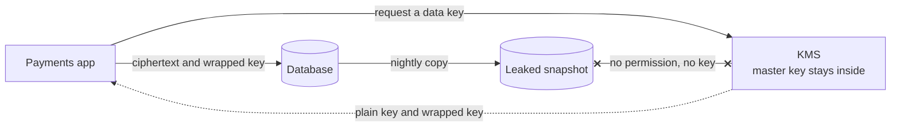

# Encryption at Rest

> Encryption at rest scrambles data where it is stored: on disks, in databases, in backups. A stolen drive or leaked snapshot is useless without the key, but anyone who can query the live system still sees plain data.

## How it works

There are three layers, from broad to narrow:

| Layer | What gets encrypted | Who still sees plain data |
|---|---|---|
| Disk or volume | Every block on the drive | Anything running on the machine |
| Database | Data files and backups, by the database engine | Anyone who can run queries |
| Field level | Chosen columns, by your app, before writing | Only code holding the key |

Field level encryption hides card numbers even from a database admin, but you lose easy search and sorting on those columns.

The keys live in a key management service (KMS), like AWS KMS or Google Cloud KMS. It keeps master keys inside the service, often in guarded hardware, and never lets them out. You ask it to encrypt or decrypt for you, and it can log every request.

KMS only encrypts small payloads, up to 4 KB per call on AWS, so systems use envelope encryption. Your app asks KMS for a new data key and gets it back twice: once in plain form, and once wrapped, meaning encrypted by the master key. It encrypts the data locally with the plain key, throws that key away, and stores the wrapped key next to the data. To read, it sends the small wrapped key to KMS, gets the plain key back, and decrypts locally. Cut off access to the master key and every file it protects goes dark at once.

The catch: "encrypted at rest" on a checklist does nothing against SQL injection or a stolen app password. The database decrypts happily for any valid query. This kind of encryption protects against lost hardware and leaked files, not attackers who come in through the front door.

## Example

A payments API takes nightly database snapshots and copies them to a storage bucket. One day a bad policy change makes that bucket public for six hours.

The snapshots were encrypted with a KMS key that only the backup role may use. Whoever downloaded them got gigabytes of noise, and the KMS logs show no decrypt calls from anyone else.

The same review finds the real gap. A SQL injection in an old reporting endpoint could have read full card numbers straight from the live database, encrypted disks or not. So card numbers now get field level encryption in the app, with a separate key the reporting service has no permission to use. Reports show only the last 4 digits.

## Picture it

The app encrypts with a data key and stores only the wrapped copy beside the data. The master key never leaves KMS, so a leaked snapshot without KMS permission is just noise.

## Related

[Encryption in Transit](encryption-in-transit.md) · [Secrets Management](secrets-management.md) · [Backups](../21-disaster-recovery/backups.md) · [SQL Injection](../17-web-security/sql-injection.md) · [IAM](iam.md)

---

[← Encryption in Transit](encryption-in-transit.md) · [All concepts](../../README.md) · [Zero Trust →](zero-trust.md)
