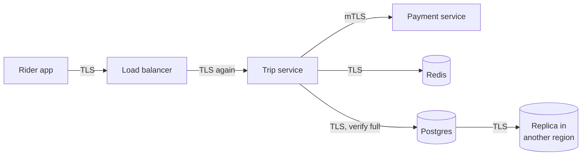

# Encryption in Transit

> Encryption in transit means every network hop carries encrypted data, not just the one from the user's browser to your edge. Calls between services, database connections, and cache traffic all count.

## How it works

The common setup encrypts the public edge and nothing else. HTTPS ends at the load balancer, and from there requests travel in plain text to services, to Postgres, to Redis, to Kafka. The thinking is that the internal network is private.

It is less private than it looks. A compromised container can listen to its neighbors. One bad firewall rule can expose a port. Traffic between data centers can cross cables you do not own. In 2013, documents leaked by Edward Snowden showed the NSA tapping links between Google's data centers, and Google responded by encrypting that internal traffic.

The policy is simple: encrypt every hop.

- **Edge to backend.** The load balancer decrypts, inspects, and encrypts again on the way to the service.
- **Service to service.** Mutual TLS, where both sides show certificates. A service mesh can add it to every call.
- **Databases and caches.** Postgres, MySQL, Redis, and Kafka all support TLS. Turn it on, then make the server refuse plain connections.
- **Replication and backups.** Replicas syncing across regions and backups being copied are traffic too.

The cost is small. Modern CPUs have built in instructions for encryption, and the main expense is the handshake, which reused connections pay only once.

The catch: clients that quietly fall back to plain text. libpq, the standard Postgres client library, defaults to `sslmode=prefer`. That uses TLS if the server offers it and silently connects unencrypted if not. Use `verify-full`, which demands TLS and checks the server's certificate and host name.

## Example

A ride sharing app has HTTPS at the edge and plain HTTP inside. An audit traces one trip request: rider GPS points and a payment token cross 6 internal hops unencrypted, including a call to Redis and a write to Postgres.

The fix rolls out over a month. A service mesh adds mutual TLS between all 25 services without code changes. Redis gets TLS turned on. The Postgres server is set to reject anything that is not TLS, and every connection string changes to demand it:

```
postgres://trips@db.internal:5432/trips?sslmode=verify-full&sslrootcert=/etc/ssl/db-ca.pem
```

CPU use on the services goes up about 2%. The next audit finds zero plain text hops.

## Picture it



Every arrow is encrypted, not just the first one. The hops people forget are the ones after the load balancer, especially to the database and its replica in another region.

## Related

[TLS](tls.md) · [Service Mesh](../15-architecture/service-mesh.md) · [Zero Trust](zero-trust.md) · [Encryption at Rest](encryption-at-rest.md) · [End to End Principle](../24-principles/end-to-end-principle.md)
