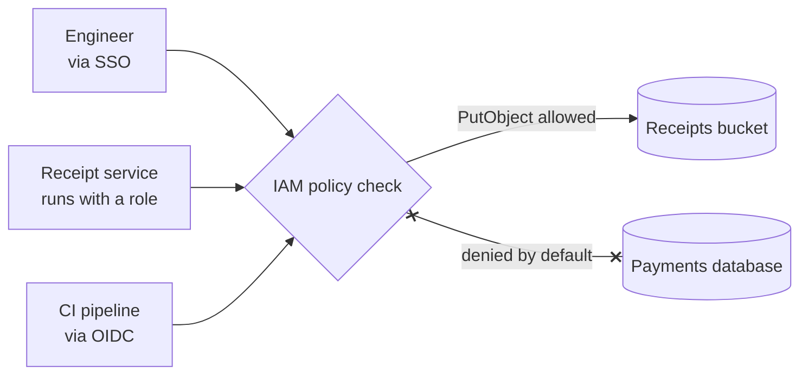

# IAM

> IAM, short for identity and access management, is how a cloud decides who can do what. Every person and every program gets an identity, and policies spell out which actions each one may take on which resources.

## How it works

Three nouns cover most of it:

- **Principals.** Whoever is making the call: a person signed in through single sign on (SSO), a service running on a VM, a CI pipeline that deploys code.
- **Policies.** Documents that say "allow these actions on these resources", like `s3:GetObject` on one bucket. Anything not allowed is denied by default, and in AWS an explicit deny beats any allow.
- **Roles.** An identity with policies attached that a principal can take on for a while. Assuming a role hands back credentials that expire, often within an hour.

Two rules keep IAM safe.

Least privilege: grant the smallest set of actions on the smallest set of resources that still lets the job work. A service that writes receipts to one bucket gets `s3:PutObject` on that bucket and nothing else.

No long lived keys: an access key pasted into a config file works forever, for anyone who finds it. Use the identity the platform already gives your code. A Lambda function, a VM, or a Kubernetes pod can run with a role, and the cloud hands it fresh short lived credentials automatically. CI systems like GitHub Actions can trade a signed token (OIDC) for a role, so no key sits in CI settings either. People sign in through SSO and get temporary sessions.

The catch: `"Action": "*"` on `"Resource": "*"`, added "just to get it working" and never removed. The ticket closes, and that service can now delete every database in the account. Clouds can show which permissions a role actually used. Trim to that.

## Example

A food delivery app's receipt service turns orders into PDFs and drops them in a storage bucket. Version one used an access key with admin rights, kept in an environment variable. A debug log printed the environment, the logs went to a third party tool, and a week later someone was mining crypto on 50 large VMs billed to the account.

Version two has no key at all. The service runs with a role whose entire policy is below. Its credentials rotate on their own every few hours, and if they leak, the attacker can write receipts and nothing more.

```json
{
  "Version": "2012-10-17",
  "Statement": [{
    "Effect": "Allow",
    "Action": "s3:PutObject",
    "Resource": "arn:aws:s3:::receipts-prod/*"
  }]
}
```

## Picture it



Every caller, human or machine, passes the same policy check with a short lived identity. The receipt service can write receipts, and everything outside its policy is a hard no.

## Related

[Secrets Management](secrets-management.md) · [Role Based Access Control](role-based-access-control.md) · [Zero Trust](zero-trust.md) · [Infrastructure as Code](../19-build-and-infra/infrastructure-as-code.md) · [Principle of Least Privilege](../24-principles/principle-of-least-privilege.md)

---

[← Role Based Access Control](role-based-access-control.md) · [All concepts](../../README.md) · [Secrets Management →](secrets-management.md)
