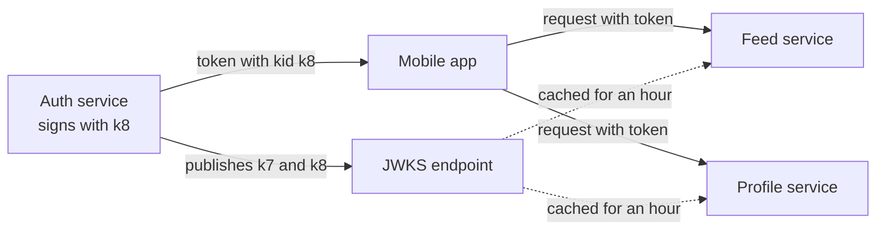

# JWT Rotation

> A JWT is a signed token any service can check without calling the auth server. Rotation means swapping the signing key on a schedule without logging everyone out, and keeping tokens short lived because a JWT is hard to take back.

## How it works

A JSON Web Token has three parts: a header, a JSON payload like `{"sub": "user_88", "exp": 1754000000}`, and a signature. The auth service signs with a private key. Any other service checks the signature with the matching public key. No database lookup, no call to the auth service.

To change keys without breaking anything, two pieces work together:

- **Key ID.** Every token header carries a `kid` that names the key that signed it.
- **Key set.** The auth service publishes all valid public keys as a JSON Web Key Set (JWKS) at a URL like `/.well-known/jwks.json`. Services fetch it, cache it, and look up each token's `kid` in it.

Rotation then runs in a fixed order. Publish the new key first. Wait until every service's cache has picked it up. Start signing with it. Keep the old key in the set until the last token it signed has expired, then remove it.

Short lifetimes matter because you cannot easily revoke a JWT. Services only check the signature and claims like the expiry, so a stolen token works until it runs out. A denylist of revoked tokens fixes that, but then every request does a lookup again. So access tokens are kept short, often 5 to 15 minutes, and a longer lived refresh token, which the auth service does check, gets new ones.

Refresh tokens rotate too. Each use returns a new refresh token and kills the old one. If a dead one ever shows up again, someone copied it, so revoke that whole chain.

The catch: dropping the old key too early. Every token it signed fails at once, and all your users get logged out in the same second.

## Example

A social feed's auth service signs tokens that 30 services verify. The policy: rotate keys every 90 days, access tokens live 10 minutes, and services refresh their cached key set every hour.

On rotation day, new key `k8` joins the key set at 9:00. Signing switches to it at 11:00, after every cache has refreshed at least once. Tokens signed with old key `k7` keep working until they expire, so `k7` is removed the next day.

The year before, someone added the new key, switched signing, and removed the old key in one deploy. Services with a stale cached key set rejected every new token, and older tokens failed as soon as caches refreshed. For an hour, nobody could stay logged in.

```json
{"keys": [
  {"kid": "k7", "kty": "RSA", "alg": "RS256", "use": "sig", "n": "...", "e": "AQAB"},
  {"kid": "k8", "kty": "RSA", "alg": "RS256", "use": "sig", "n": "...", "e": "AQAB"}
]}
```

## Picture it



Services never call the auth service to check a token. They match the token's key ID against a cached copy of the key set, which is why a new key must be published well before anything is signed with it.

## Related

[OAuth](oauth.md) · [Secrets Management](secrets-management.md) · [Authentication vs Authorization](authentication-vs-authorization.md) · [Caching](../06-caching/caching.md)
