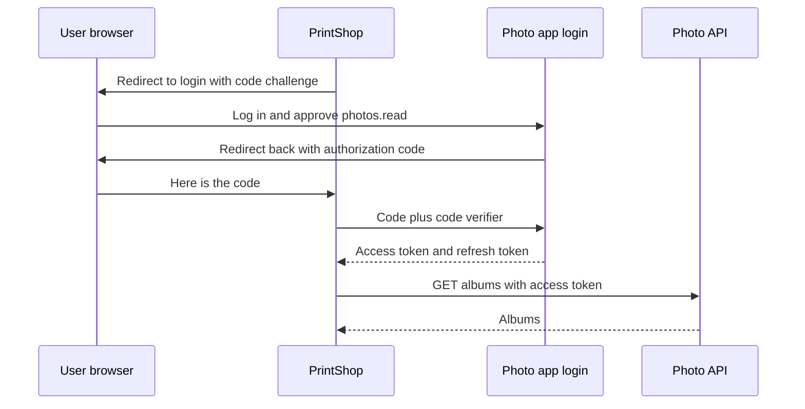

# OAuth

> OAuth lets one app use your data in another app without ever seeing your password. You approve a limited scope once, and the app gets a token that can only do what you approved.



## How it works

Say a printing site wants your albums from a photo sharing app. The bad old way: you type your photo app password into the printing site. Now it can do everything you can, forever, and you cannot cut off just that one app.

With OAuth 2.0, the photo app runs an authorization server that hands out tokens. The modern flow is the authorization code flow with PKCE (Proof Key for Code Exchange):

1. The printing site makes a random secret, the code verifier. It sends you to the photo app's login page with a hash of that secret and the scope it wants, like `photos.read`.
2. You log in on the photo app's own page and approve.
3. The photo app redirects you back with a short lived authorization code.
4. The printing site trades the code plus the original verifier for tokens. The server checks the verifier against the hash, so a stolen code on its own is worthless.

You end up with two tokens. The access token rides along on every API call and often expires within an hour. The refresh token lasts much longer and buys new access tokens. Revoke it, and the app is cut off once its current access token runs out.

OAuth answers "may this app call this API". It does not say who the user is. OpenID Connect adds that on top with an ID token, a signed note saying which user just logged in. "Sign in with Google" is OpenID Connect.

Watch out: using an OAuth access token as proof of login. A token handed to some other app can be replayed at yours. For login, use OpenID Connect and check that the ID token was issued for your app.

## Example

A printing site called PrintShop connects to a photo sharing app. The user clicks "Import albums" and lands on the photo app's consent screen: PrintShop wants to view your photos, and cannot delete or post. She clicks Allow.

PrintShop now holds a 1 hour access token and a refresh token, both limited to reading photos. Months later she decides it should not have access anymore. She removes PrintShop in the photo app's settings, the refresh token is revoked, and imports stop within the hour. Her password never left the photo app.

```http
GET /authorize?response_type=code&client_id=printshop
    &scope=photos.read&state=k29x
    &redirect_uri=https://printshop.example/callback
    &code_challenge=E9Melhoa2OwvFrEMTJguCHaoeK1t8URWbuGJSstw-cM
    &code_challenge_method=S256
Host: photos.example
```

## Picture it



The password only ever goes to the photo app's own login page. PrintShop sees a one time code, proves it started the flow by sending the verifier, and leaves with tokens that can only read photos.

## Related

[Authentication vs Authorization](authentication-vs-authorization.md) · [JWT Rotation](jwt-rotation.md) · [CSRF](../17-web-security/csrf.md) · [TLS](tls.md) · [API Gateways](../03-traffic/api-gateways.md)

---

[← Password Hashing](password-hashing.md) · [All concepts](../../README.md) · [JWT Rotation →](jwt-rotation.md)
