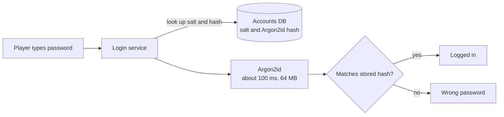

# Password Hashing

> Never store passwords. Store a slow, salted hash of each one, so that when your database leaks, attackers get a pile of values that are painfully expensive to turn back into passwords.



## How it works

A hash is a one way function: easy to compute from the password, practically impossible to reverse. At signup you store the hash. At login you hash what the user typed and compare. You never need the original password again.

But a plain fast hash like SHA256 is the wrong tool. It was built for speed, and a single modern GPU can try billions of SHA256 guesses per second. Hashes of common passwords fall in minutes.

Good password hashing adds two things:

- **A salt.** A random value, unique per user, stored next to the hash. Two users with the password `dragon123` get completely different hashes, and precomputed tables of password hashes, like rainbow tables, become useless.
- **Deliberate slowness.** bcrypt, scrypt, and Argon2 are tuned so one hash takes something like 100 ms. A user logging in never notices. If one guess costs 100 ms instead of a nanosecond, a billion guesses go from one second to about three years of compute. scrypt and Argon2 also demand lots of memory per guess, which hurts GPUs most.

Argon2id is the first choice in OWASP's current guidance, and bcrypt is still fine for existing systems. Libraries store the algorithm, the cost settings, and the salt inside the hash string itself. So you can raise the cost later and quietly rehash each user at their next login.

The catch: inventing your own scheme. `sha256(salt + password)` looks responsible and is still fast enough to crack at scale. Use a well known library and its defaults.

## Example

A multiplayer game leaks its accounts table: 2 million rows. In version one, passwords were stored as unsalted SHA256. Within a day, attackers crack most of them, because players reuse passwords that already sit in public leak lists. Every player using `qwerty123` shares one hash, so cracking it once cracks thousands of accounts.

After the fix, each row holds an Argon2id hash with its own salt. The same leak now forces attackers to go after each account separately, at 64 MB of memory and a fraction of a second per guess. Only the weakest passwords fall. The team still forces a reset, but most accounts are safe in the meantime.

```python
from argon2 import PasswordHasher

ph = PasswordHasher()
stored = ph.hash("qwerty123")   # $argon2id$v=19$m=65536,t=3,p=4$<salt>$<hash>
ph.verify(stored, "qwerty123")  # raises VerifyMismatchError if wrong
```

## Picture it



The password itself is never stored anywhere. The login service hashes the typed password with the stored salt and compares the results, and that slow hashing step is what makes a stolen database so expensive to attack.

## Related

[Authentication vs Authorization](authentication-vs-authorization.md) · [Secrets Management](secrets-management.md) · [Encryption at Rest](encryption-at-rest.md) · [Rate Limiting](../03-traffic/rate-limiting.md) · [Kerckhoffs's Principle](../24-principles/kerckhoffs-principle.md)

---

[← Authentication vs Authorization](authentication-vs-authorization.md) · [All concepts](../../README.md) · [OAuth →](oauth.md)
