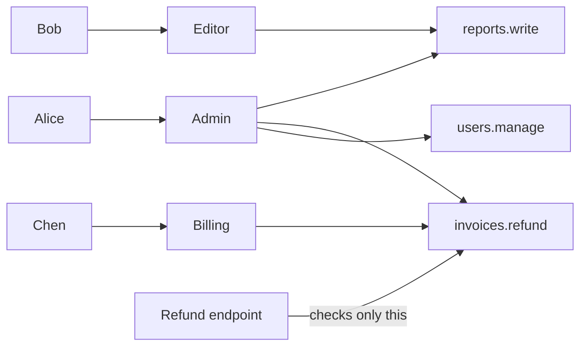

# Role Based Access Control

> Role based access control gives users roles, and gives roles permissions. Instead of deciding access person by person, you decide it once per job, like admin, editor, or viewer.

## How it works

Three lists do the work. Users get one or more roles. Roles get a set of permissions. A permission is an action on a kind of thing, like `invoices.read` or `users.invite`. When a request comes in, you gather the permissions from all of the user's roles and check for the one this action needs.

Roles are usually scoped. Alice can be admin in the Acme workspace and viewer in the Globex one, so the real question is "does Alice have `invoices.read` in this workspace?"

New hire? Give them the editor role. Someone switches teams? Swap one role. That is the point: access follows the job, not the person.

The catch: checking roles in code. `if user.role == "admin"` scattered across 40 handlers means every new role is a code change in 40 places. Check permissions instead, like `can(user, "invoices.refund")`, and keep the mapping from roles to permissions in data. Adding a billing manager role becomes one new entry.

Then there is role explosion. Customers ask for "editor but no deletes", "viewer for the EU region only", "admin minus billing". Make a role for each and you end up with 400 roles nobody understands. When rules depend on details of the user or the record, like region or owner, you have outgrown plain roles. Attribute based access control (ABAC) handles rules like "same region", and relationship based systems like Google's Zanzibar handle "people this doc was shared with". Most teams keep a small set of roles alongside them.

## Example

A SaaS dashboard ships with three roles. A big customer asks for a fourth: someone who can manage invoices and refunds but cannot touch reports or users.

Because handlers check permissions, the change is one new entry in the role map:

```python
ROLES = {
    "viewer":  {"reports.read"},
    "editor":  {"reports.read", "reports.write"},
    "billing": {"invoices.read", "invoices.refund"},  # new, no handler changes
    "admin":   {"reports.read", "reports.write", "invoices.read",
                "invoices.refund", "users.manage"},
}

def can(user, perm):
    return any(perm in ROLES[r] for r in user.roles)
```

The refund handler already calls `can(user, "invoices.refund")`, so the new role works the moment it ships. If handlers had checked for the admin role by name, this would have been a two week hunt through the codebase.

## Picture it



People point at roles, roles point at permissions, and the code only ever asks about the permission. Add or change a role, and the refund endpoint never needs to know.

## Related

[Authentication vs Authorization](authentication-vs-authorization.md) · [IAM](iam.md) · [Multitenancy](../15-architecture/multitenancy.md) · [Zero Trust](zero-trust.md)
