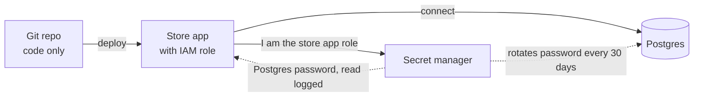

# Secrets Management

> Secrets management keeps passwords, API keys, and signing keys out of your code and your git history. They live in one locked, audited place, get handed to apps at run time, and get rotated regularly.

## How it works

A secret in source code is shared with everyone who can read the repo, every laptop with a clone, and every CI log that prints it. Git also never forgets. Deleting the line in a new commit leaves the key sitting in history, and bots scan public repositories for keys around the clock.

So secrets move into a dedicated store: HashiCorp Vault, or a cloud service like AWS Secrets Manager, Google Cloud Secret Manager, or Azure Key Vault. Secrets are encrypted there, access is granted per app, and every read can be logged. The app proves who it is with its platform identity, like a cloud IAM role, and fetches what it needs at startup. That identity is all it brings, so no master password gets baked into the image.

Then rotate. Change secrets on a schedule, and right away after any leak. A smooth rotation keeps two versions valid for a while: create the new password, roll it out to every app, then retire the old one.

The best secret expires on its own. Vault can create a fresh database user for each app instance with a 1 hour lifetime, then delete it. A credential that leaks at 9:00 is useless by 10:00.

The catch: thinking a committed secret is fixed once you delete it from the file. It leaked. Rotate it first, then clean up. Turn on secret scanning so the next one gets blocked before the push.

## Example

A developer at an online store commits a `.env` file to a public repo. It holds the Postgres password and a live Stripe secret key. Deleting the file in the next commit does nothing, because the history still has it.

The cleanup order matters. First, roll the Stripe key in the Stripe dashboard and change the database password, so the leaked values are dead. Then move both into AWS Secrets Manager. The app's IAM role may read only secrets under `prod/store/`, and the app loads them at boot. The database password now rotates every 30 days by itself, and a scanner in the commit hook rejects anything that looks like a key.

```python
import boto3, json

sm = boto3.client("secretsmanager")
raw = sm.get_secret_value(SecretId="prod/store/stripe")["SecretString"]
STRIPE_KEY = json.loads(raw)["api_key"]
```

## Picture it



The repo ships code with no secrets in it. The app proves its identity to the secret manager and gets the password at boot, and the manager rotates that password on the database by itself.

## Related

[IAM](iam.md) · [Encryption at Rest](encryption-at-rest.md) · [JWT Rotation](jwt-rotation.md) · [CI/CD](../19-build-and-infra/ci-cd.md) · [Password Hashing](password-hashing.md)

---

[← IAM](iam.md) · [All concepts](../../README.md) · [TLS →](tls.md)
