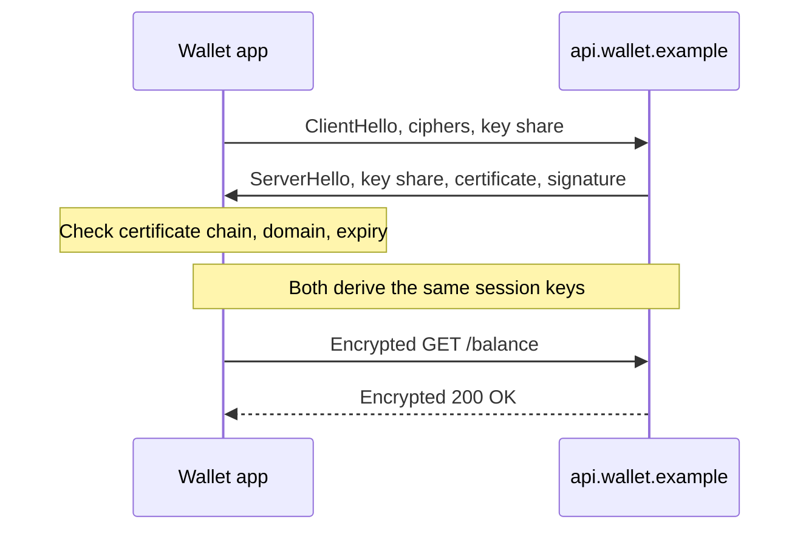

# TLS

> TLS is the protocol that puts the S in HTTPS. It encrypts traffic, catches tampering, and proves you are talking to the real server, which is why cafe wifi does not hand your bank login to the person at the next table.

## How it works

Before any app data flows, client and server run a handshake. In TLS 1.3 it takes one round trip:

1. The client says hello: the TLS versions and ciphers it supports, plus its half of a key exchange.
2. The server answers with its half, its certificate, and a signature proving it holds the private key that matches the certificate.
3. Both sides combine the two halves, a trick called a Diffie Hellman exchange, into the same session keys. The keys themselves never cross the wire.
4. From here on, everything is encrypted with those keys. In TLS 1.3 that starts right after the key exchange, so even the certificate travels encrypted.

A certificate ties a domain name, like `api.wallet.example`, to a public key. It is signed by a certificate authority (CA), an organization your browser and operating system already trust, like Let's Encrypt or DigiCert. Usually there is a chain: your certificate is signed by an intermediate, which is signed by a trusted root. The client checks the chain, the domain name, and the expiry date. Certificates expire within months, so renewal has to be automated.

You get three guarantees. Privacy: anyone watching the network sees noise. Integrity: one changed byte fails the check and kills the connection. Server identity: an impostor cannot show a valid certificate for your domain. TLS does not usually hide which site you are visiting, and it says nothing about whether the server itself is honest.

Watch out: turning off certificate checks to make an error go away, like `verify=False` or `curl -k`. The traffic is still encrypted, but you no longer know who you encrypted it for, so an attacker in the middle can read all of it.

## Example

A wallet app user joins free wifi at a cafe. The hotspot is fake, run by someone who forwards all traffic and watches it.

The app connects to `api.wallet.example`. The attacker can intercept the connection but cannot present a valid certificate for that domain, because no trusted CA will issue him one. The app's certificate check fails, the connection closes, and the user sees a network error instead of handing over a session token.

The same week, a developer ships a debug build with certificate checks disabled "just for staging". On that build, the fake hotspot would have read every request. The team adds a CI check that fails any release with certificate verification turned off.

## Picture it

One round trip sets everything up. The certificate check in the first note is where server identity comes from, and the session keys in the second note never travel over the network.

## Related

[Encryption in Transit](encryption-in-transit.md) · [HTTP/2 and HTTP/3](../04-networking/http2-and-http3.md) · [Zero Trust](zero-trust.md) · [CDN](../03-traffic/cdn.md) · [Service Mesh](../15-architecture/service-mesh.md)

---

[← Secrets Management](secrets-management.md) · [All concepts](../../README.md) · [Encryption in Transit →](encryption-in-transit.md)
