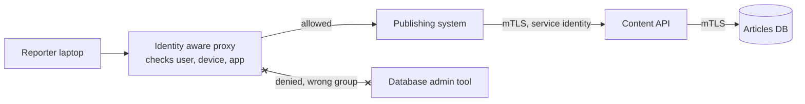

# Zero Trust

> Zero trust drops the idea of a safe internal network. Every request, from a person or a service, has to prove who it is and gets only the access it needs, no matter where it comes from.

## How it works

The old model is a castle with a moat. The VPN is the drawbridge, and once you are inside, the wiki, the admin panel, and the database console all trust you because of your IP address. One phished password and the attacker is inside too, free to wander.

Zero trust assumes the attacker is already on the network, so being on it earns nothing. Google moved its own staff to this model after a 2009 attack, called it BeyondCorp, and published how it works. NIST later wrote up a reference architecture for it.

In practice:

- **Identity aware proxy.** Internal apps sit behind a proxy that checks every request: who the user is through single sign on, whether their laptop is a managed and patched device, and whether this user may use this app. Google's IAP and Cloudflare Access work this way.
- **Service identity.** Services prove who they are to each other with mutual TLS, each holding a certificate that names the service. Payments accepts calls from checkout, not from anything that happens to be on the network.
- **Least privilege.** Access is granted per app and per action, to groups, and it expires.
- **Constant checking.** Sessions are short, and a laptop that misses a security update loses access on its next request.

The catch: buying a "zero trust" product to replace the VPN while your services still trust each other by IP address. You moved the front door and left every inner door open. The same rules have to hold for traffic between your own services.

## Example

A news site keeps its publishing system, analytics, and database admin tool behind a VPN. An attacker phishes one sports reporter's VPN password. Once connected, the attacker opens the database admin tool, which trusts anyone on the internal network, and downloads the subscribers table.

After the rebuild, there is no VPN. Each tool sits behind an identity aware proxy that requires single sign on with a hardware security key, from a company managed laptop. The sports desk's group can open the publishing system and nothing else. The database tool allows only the 4 people on the data team, and the database itself accepts connections only from services with the right certificate. The same phished password now gets the attacker a prompt for a security key they do not have.

## Picture it

No request is trusted for coming from the right network. The proxy checks the person and the device for each app, and inside, services check each other's certificates before they talk.

## Related

[Authentication vs Authorization](authentication-vs-authorization.md) · [IAM](iam.md) · [Encryption in Transit](encryption-in-transit.md) · [Service Mesh](../15-architecture/service-mesh.md) · [Role Based Access Control](role-based-access-control.md)
