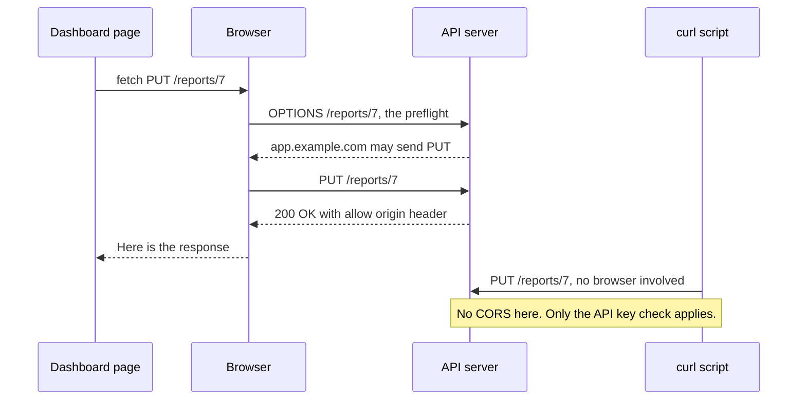

# CORS

> CORS is the browser rule that decides which other websites may read responses from your API. It protects your users' browsers, not your server, and that second part is what almost everyone gets wrong.

## How it works

Browsers follow the same origin policy. An origin is the scheme (http or https), host, and port, so `https://app.example.com` and `https://api.example.com` are different origins. A script on one origin can send a request to another, but the browser won't let the script read the response unless the server says it may.

CORS (Cross Origin Resource Sharing) is how the server says it. The response carries an `Access-Control-Allow-Origin` header naming who may read it. No header, no read. For a simple request, the server still got it and still ran it. The page just never sees the answer.

For anything beyond a plain GET or a simple form post, like a `PUT`, a JSON content type, or an `Authorization` header, the browser first sends a preflight. That's an `OPTIONS` request asking "may I?". The server answers with the methods and headers it allows, and only then does the real request go out. `Access-Control-Max-Age` lets the browser cache that answer, so you don't pay an extra round trip on every call.

Want cookies included? The server must name one exact origin, not `*`, and send `Access-Control-Allow-Credentials: true`.

The catch: CORS does not protect your server. curl, Postman, scripts, and other servers ignore it completely. It only stops a script on someone else's site from reading your users' data through their own logged in browser. Your API still needs real authentication on every request.

## Example

A SaaS dashboard lives at `app.example.com` and calls its API at `api.example.com`. The first deploy shows empty charts and a console full of "blocked by CORS policy". The API did answer. The browser just refused to hand the answer to the page.

A developer "fixes" it by copying whatever `Origin` header arrives into the allow header, with credentials on. That tells browsers every website on the internet may read the API's responses with the customer's cookies attached. That's worse than having no CORS setup at all.

The real fix is an allow list of one:

```http
HTTP/1.1 200 OK
Access-Control-Allow-Origin: https://app.example.com
Access-Control-Allow-Credentials: true
```

Meanwhile, a scraper hitting the API with curl never sees any of this. It gets stopped by the API key check, which is the thing that actually protects the server.

## Picture it



The browser runs the preflight and checks the allow header before the page sees anything. The curl script skips both steps and talks to the API directly, which is why CORS can never be your server's security.

## Related

[CSRF](csrf.md) · [XSS](xss.md) · [API Gateways](../03-traffic/api-gateways.md) · [Authentication vs Authorization](../16-identity-and-encryption/authentication-vs-authorization.md)
