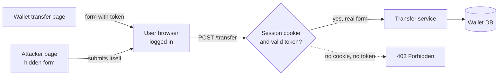

# CSRF

> Cross site request forgery tricks a logged in user's browser into sending a request they never meant to send. The browser attaches their cookies automatically, so your server sees a perfectly valid session.

## How it works

Browsers attach your site's cookies to requests to your site, even when a different site started them, unless the cookie says otherwise. So if a user is logged in to `wallet.example` and visits a sketchy page, that page can hold a hidden form that posts to `wallet.example/transfer`. The browser sends it with the session cookie. Your server sees a real user asking to move money.

The attacker never sees the response. They don't need to. The damage is the action itself: a transfer, a password change, a new email address on the account.

Two defenses, and you want both:

- **SameSite cookies.** A cookie setting that tells the browser when to leave the cookie off requests started by other sites. `Strict` never sends it cross site. `Lax` sends it only on top level GET navigations, like clicking a link to your site. Chrome treats cookies with no setting as `Lax`, but set it yourself instead of trusting the default.
- **CSRF tokens.** The server puts a random secret, tied to the session, in each form. Every request that changes something must send it back. Another site can't read your pages, so it can't know the token.

APIs that send a token in an `Authorization` header instead of a cookie are not exposed to CSRF, because browsers never attach that token on their own.

Watch out: never change anything on a GET request. `Lax` cookies still ride along when the user follows a link, so a `GET /account/delete` endpoint is one malicious link away from deleting accounts.

## Example

A wallet app keeps its session in a cookie marked `SameSite=None` and has a `POST /transfer` endpoint. An attacker emails users a link to a page with a hidden form that submits itself the moment it loads:

```html
<form action="https://wallet.example/transfer" method="POST">
  <input type="hidden" name="to" value="attacker">
  <input type="hidden" name="amount" value="500">
</form>
<script>document.forms[0].submit()</script>
```

Before the fix, every logged in user who opens that page sends $500. After the fix, the session cookie is `SameSite=Lax`, so the browser leaves it off the cross site POST and the request arrives logged out. The real transfer form also carries a CSRF token, so even an old browser that ignores SameSite gets a 403, because the forged form has no token.

## Picture it



Both requests leave the same browser. Only the one started by the wallet's own page carries the session cookie and the token, so the forged one is rejected before it gets near the money.

## Related

[CORS](cors.md) · [XSS](xss.md) · [Authentication vs Authorization](../16-identity-and-encryption/authentication-vs-authorization.md) · [OAuth](../16-identity-and-encryption/oauth.md)
