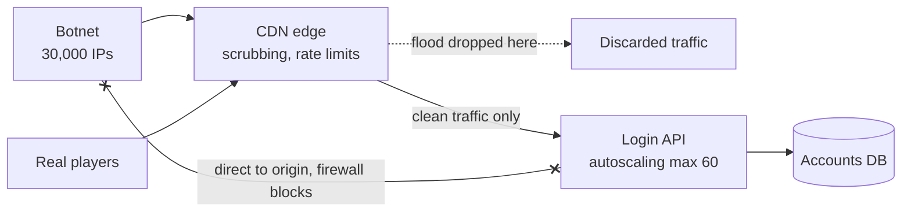

# DDoS Protection

> A distributed denial of service attack floods you from thousands of machines at once until real users can't get in. You can't outgrow one on your own servers, so you absorb it at the edge.

## How it works

Floods come in two main shapes:

| Type | What arrives | Measured in |
|---|---|---|
| Volumetric | Junk packets, often bounced off open servers to multiply them | Gigabits per second |
| Application layer | Real looking HTTP requests to expensive pages like search or login | Requests per second |

A volumetric flood fills your network pipe before a single packet reaches your code. Your only option is to stand behind someone with a far bigger pipe. A CDN or scrubbing service (a network built to filter attack traffic), like Cloudflare, AWS Shield, or Akamai, spreads the flood across hundreds of locations, drops the junk, and forwards only clean traffic. In 2018 GitHub was hit with 1.35 terabits per second and recovered within minutes by routing through one.

Application layer floods are harder, because each request looks like a real visitor. You stack defenses at the edge: cache everything you can so most hits never reach your servers, rate limit per IP and per API key, and send suspicious clients a challenge that bots tend to fail. Then make sure your origin (your real servers) only accepts traffic from the CDN. If attackers find its IP, they walk right around the shield.

The catch: autoscaling is not DDoS protection. During an application layer flood it happily adds 200 servers, your database falls over anyway, and the bill shows up at the end of the month. Put a hard cap on autoscaling and stop the flood before it reaches you.

## Example

A multiplayer game launches a new season. Minutes later its login API gets 400,000 requests per second from 30,000 IP addresses, about 40 times normal. Autoscaling takes the API from 20 servers to 300. The accounts database behind login can't scale like that, so it falls over anyway, and real players can't sign in for two hours.

For the next launch, the team puts login behind a CDN with DDoS protection, and the origin firewall only accepts traffic from the CDN's IP ranges. Each IP gets 10 login attempts a minute, and clients that fail a challenge are dropped at the edge. Autoscaling is capped at 60 servers. The next flood is just as big, but almost all of it dies at the edge and the login servers barely notice.

## Picture it

Players and bots both hit the edge first, and the flood is dropped there. Because the origin only accepts traffic from the CDN, the bots can't go around the edge and hit the login servers directly.

## Related

[Rate Limiting](../03-traffic/rate-limiting.md) · [CDN](../03-traffic/cdn.md) · [Autoscaling](../02-scaling/autoscaling.md) · [Load Shedding](../14-reliability/load-shedding.md) · [WAF](waf.md)
