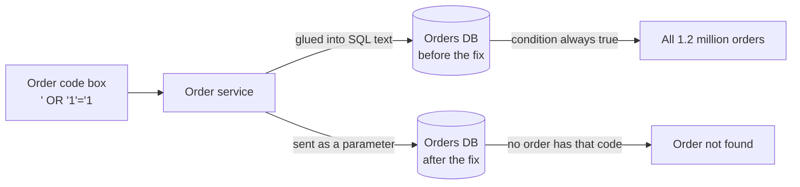

# SQL Injection

> SQL injection happens when user input gets pasted into a database query and the database runs it as code. Parameterized queries fix it, and they have been around for decades.



## How it works

The bug is gluing user input into the SQL text. If your code builds `"... WHERE email = '" + email + "'"`, the database can't tell where your query ends and the user's input begins. A user who types `' OR '1'='1` closes your quote and adds a condition that is always true. The query now matches every row in the table. Nastier inputs can read other tables or delete data.

The fix is a parameterized query, also called a prepared statement. You send the SQL with placeholders, like `WHERE email = $1`, and send the values separately. The database parses the query first, then plugs in the values as plain data. Whatever the user types, it can never become SQL. Every mainstream database driver supports this, and ORMs (libraries that write SQL for you) do it by default.

Two more layers help:

- **Least privilege.** The app's database user gets only the permissions it needs. A reporting service that can only read can't drop tables.
- **Allow lists for names.** Placeholders work for values, not for table or column names. If users pick a sort column, check it against a fixed list.

Watch out: escaping quotes by hand is not the fix. People keep missing a case: a number field with no quotes, an odd character encoding, a backslash. And the ORM escape hatch, a raw SQL string built with string formatting, brings the bug right back.

## Example

An online store has a "track your order" page. Here's the lookup before and after:

```python
# Before: the input becomes part of the SQL text
db.execute(f"SELECT * FROM orders WHERE code = '{code}'")

# After: the driver passes the value as data, never as SQL
db.execute("SELECT * FROM orders WHERE code = %s", (code,))
```

With the first version, someone types `' OR '1'='1` into the order code box and the query returns every order in the table: 1.2 million names, addresses, and phone numbers. With the second, the database looks for an order whose code is literally `' OR '1'='1`, finds none, and the page says "order not found". Same input, same database, no breach.

## Picture it



Same input, two ways to send it. Glued into the SQL text, the quote breaks out and matches everything. Sent as a parameter, it is just a strange order code that matches nothing.

## Related

[XSS](xss.md) · [WAF](waf.md) · [SSRF](ssrf.md) · [Role Based Access Control](../16-identity-and-encryption/role-based-access-control.md)

---

[← XSS](xss.md) · [All concepts](../../README.md) · [SSRF →](ssrf.md)
