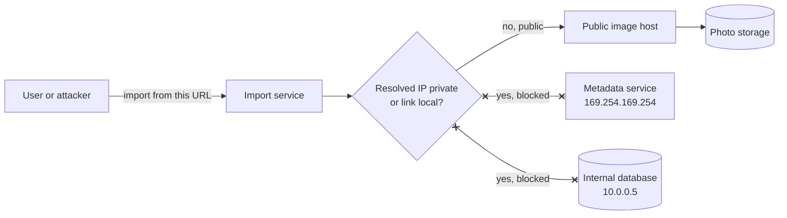

# SSRF

> Server side request forgery tricks your server into fetching a URL the attacker picked, usually an internal one they could never reach themselves. Any feature that fetches a URL a user typed is a candidate.

## How it works

Plenty of features fetch URLs for users: import a photo from a link, preview a pasted article, call a customer's webhook URL. Your server makes that request from inside your network, with access the attacker doesn't have. So the attacker hands it an internal address and reads what comes back.

The favorite target is the cloud metadata service at `169.254.169.254`. A server can ask that address about itself, and on AWS with the older setup (IMDSv1), a plain GET returns temporary credentials for the server's cloud role. One fetch and the attacker holds keys to your storage. The 2019 Capital One breach worked this way and exposed data on more than 100 million people.

Defenses, strongest first:

- **Allow lists.** If you only fetch from a few known hosts, allow those and refuse everything else.
- **Block private ranges.** Otherwise, resolve the hostname and refuse loopback, meaning the machine itself (`127.0.0.0/8`), private networks (`10.0.0.0/8`, `172.16.0.0/12`, `192.168.0.0/16`), and the link local range the metadata service lives in (`169.254.0.0/16`). Check IPv6 addresses the same way. Allow only `http` and `https`.
- **Lock down metadata.** On AWS, require IMDSv2, which needs a session token that a simple fetch can't get.
- **Isolate the fetcher.** Run URL fetching in its own service with no route into your internal network.

The catch: checking the URL text is not enough. A harmless looking hostname can resolve to `10.0.0.5`, and a public URL can redirect to the metadata address. Resolve the name, check the IP, connect to that exact IP, and recheck every redirect.

## Example

A photo sharing app lets users import a picture by pasting a link. The import service fetches the URL and saves whatever comes back as the photo. An attacker pastes the metadata address instead of a photo link, then downloads their new "photo". It's a text file holding the server's temporary cloud credentials.

The fix: the import service now resolves each hostname, refuses private and link local addresses, follows at most 3 redirects and checks each one, and only keeps responses with an image content type under 20 MB. The servers switch to IMDSv2. The same paste now gets "this link can't be imported", and the attempt shows up in the security logs.

## Picture it

The import service sits inside your network, so it can reach things the attacker can't. The check on the resolved IP, not the URL text, is what keeps it pointed at the public internet only.

## Related

[IAM](../16-identity-and-encryption/iam.md) · [Webhooks](../05-apis/webhooks.md) · [Zero Trust](../16-identity-and-encryption/zero-trust.md) · [WAF](waf.md)
