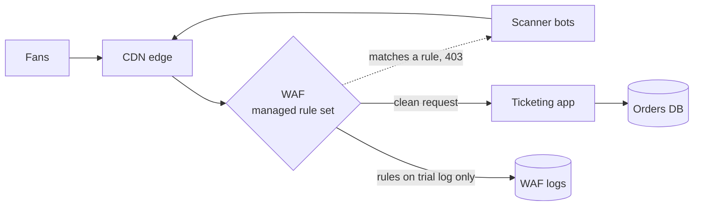

# WAF

> A web application firewall sits in front of your app and blocks requests that match known attack patterns. It buys you time and cuts the noise, but it never replaces fixing the actual bug.

## How it works

A WAF reads every HTTP request before your app does: the path, headers, query string, and body. It checks them against rules. A rule might say "block bodies that look like SQL injection", "block this IP range", or "block the exploit string for that old plugin". A match gets a 403 or a challenge. Everything else passes through.

It usually runs at the edge. Cloudflare, AWS WAF, and Akamai run it in their networks next to the CDN, or you run the open source ModSecurity engine on your own proxy.

Most teams start from managed rule sets: rule packs a vendor or community writes and keeps updated, like the OWASP Core Rule Set. When a big new vulnerability drops, vendors often ship a rule for it within a day or two, long before you can patch every service. That stopgap is called a virtual patch. Log4Shell in December 2021 is the famous case.

The tradeoff is false positives. A support ticket quoting an error with `' OR` in it, a blog post about XSS, a customer named O'Brien: all of them can look like attacks. So new rules usually start in count mode, where they log matches without blocking, until you trust them.

The catch: a WAF matches patterns, and attackers rephrase. Encode the input differently or split it across fields, and it slips through. Treat the WAF as one layer. The parameterized query is the fix. The WAF is the speed bump.

## Example

A ticketing site turns on a managed rule set in block mode on a Friday, right before a big concert goes on sale. By Saturday, support has 300 tickets from fans who can't check out. The WAF logs show one SQL injection rule matching the apostrophe in names like O'Neill and D'Angelo on the billing form.

The team adds an exception so that one rule skips the billing name field, and the rest of the set keeps blocking. Over the next week, the WAF stops about 40,000 scanner requests a day aimed at login and search. From then on, every new rule runs in count mode for a week before it is allowed to block.

## Picture it

Every request passes the rules before it reaches the app. Matches bounce with a 403, and rules still on trial only write to the logs, which is where you spot the false positives before they cost you sales.

## Related

[DDoS Protection](ddos-protection.md) · [SQL Injection](sql-injection.md) · [XSS](xss.md) · [CDN](../03-traffic/cdn.md) · [Defense in Depth](../24-principles/defense-in-depth.md)
