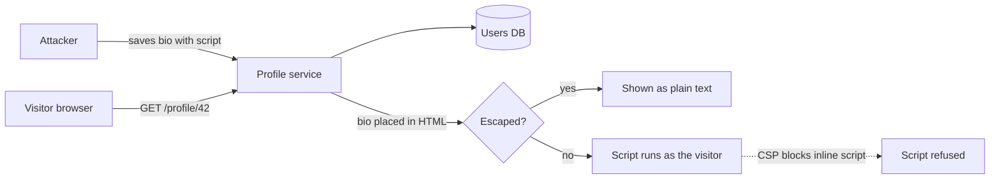

# XSS

> Cross site scripting is when an attacker gets their JavaScript to run on your page, inside your users' browsers. That script can do anything the user can do, which makes it one of the nastiest web bugs there is.



## How it works

It starts with a page that puts user input into HTML without escaping it. Someone sets their display name to `<script>alert(1)</script>`, and instead of showing that text, the browser runs it. Now the attacker's code runs on your site, with your user's session, and can read the page, send requests, and change what the user sees.

Two classic flavors:

- **Stored.** The script is saved in your database, in a comment or a bio, and runs for every visitor who views it. One post can hit thousands of users.
- **Reflected.** The script rides in a URL, like a search term echoed back on the results page. The victim has to click a crafted link, so it usually travels by email or chat.

The fix is output escaping. When you put text into HTML, turn `<` into `&lt;` and `"` into `&quot;`, so the browser shows the text instead of running it. React, Vue, and most template engines do this by default. Trouble starts when you bypass them with `innerHTML` or `dangerouslySetInnerHTML`.

Then add layers. A Content Security Policy is a response header that tells the browser which scripts may run, so an injected inline script gets refused. Marking the session cookie `HttpOnly` hides it from JavaScript, so a script can't read it.

The catch: HttpOnly stops cookie theft, not the attack. The injected script doesn't need the cookie. It can send requests from inside the page, and the browser attaches the cookie for it.

## Example

A social feed lets users write a bio. The profile page builds its HTML by gluing strings together, and nobody escapes the bio. One user saves a bio with a script tag in it. Every visitor who opens that profile runs the script, which follows the attacker and copies the bio onto the visitor's own profile. Each new profile infects its own visitors. The Samy worm did roughly this to MySpace in 2005 and reached over a million accounts in under a day.

The fix comes in three parts. The template now escapes the bio, so the tag shows up as harmless text. A CSP header blocks inline scripts as a backup. And the session cookie is HttpOnly, so a future bug can't ship it to someone else's server.

```http
Content-Security-Policy: script-src 'self'
Set-Cookie: session=abc123; HttpOnly; Secure; SameSite=Lax
```

## Picture it



The same stored bio goes to every visitor. Whether it shows up as text or runs as code depends only on the escaping step, with CSP as a second net underneath.

## Related

[CSRF](csrf.md) · [SQL Injection](sql-injection.md) · [CORS](cors.md) · [WAF](waf.md)

---

[← CSRF](csrf.md) · [All concepts](../../README.md) · [SQL Injection →](sql-injection.md)
