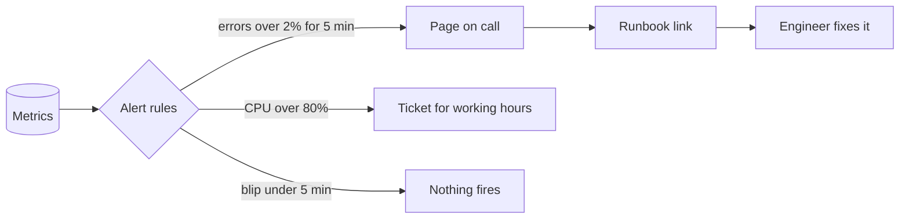

# Alerts

> An alert wakes a human when something needs fixing right now. Page on what users feel, make every page actionable, and keep the volume low enough that people still take each one seriously.

## How it works

An alert is a rule over your metrics, like "checkout error rate above 2 percent for 5 minutes". When it fires, it either pages someone (their phone buzzes, day or night) or opens a ticket for working hours. Most of the skill is deciding which.

Page on symptoms, not causes. A symptom is something users feel: errors, slow pages, failed checkouts. A cause is something that might lead there: CPU at 90 percent, a container restart, a disk at 70 percent. Causes often fix themselves or never hurt anyone. A symptom alert also catches the failures you never thought to write a rule for.

Every page must be actionable. If the person paged can't do anything, or it can safely wait until morning, make it a ticket or a dashboard panel. Each alert should link to a runbook: what it means, where to look, and how to stop the bleeding.

The duration, like "for 5 minutes", matters too. It keeps a 20 second blip from waking anyone and cuts down on the alert flapping on and off.

Watch out for alert fatigue. Every noisy alert teaches the team that alerts don't matter. At 30 pages a week, people hit acknowledge without reading, and the real outage gets the same shrug as the fake ones. Delete or downgrade any alert that fired without needing action. A good on call week has a handful of pages, and every one is real.

## Example

A news site's on call rotation gets about 60 pages a week: CPU above 80 percent, disk above 70 percent, any container restart. On election night, the homepage starts failing for 15 percent of readers. That page lands between two CPU alerts, and the engineer acknowledges all three from bed. Nobody notices for 25 minutes, until readers complain on social media.

Afterward, the team turns every cause alert into a ticket or a dashboard panel and keeps two pages, both about readers:

```yaml
- alert: HomepageErrors
  expr: homepage_error_ratio > 0.02
  for: 5m
  labels: {severity: page}
- alert: HomepageSlow
  expr: homepage_p99_seconds > 3
  for: 10m
  labels: {severity: page}
```

Pages drop to about 3 a week, and each one gets a real look.

## Picture it



Only the symptom users feel wakes someone up, and it arrives with a runbook. Causes go to a ticket queue, and short blips never fire at all.

## Related

[On Call](../22-operations/on-call.md) · [Runbooks](../22-operations/runbooks.md) · [Monitoring](monitoring.md) · [SLOs](slos.md) · [Error Budgets](error-budgets.md)
