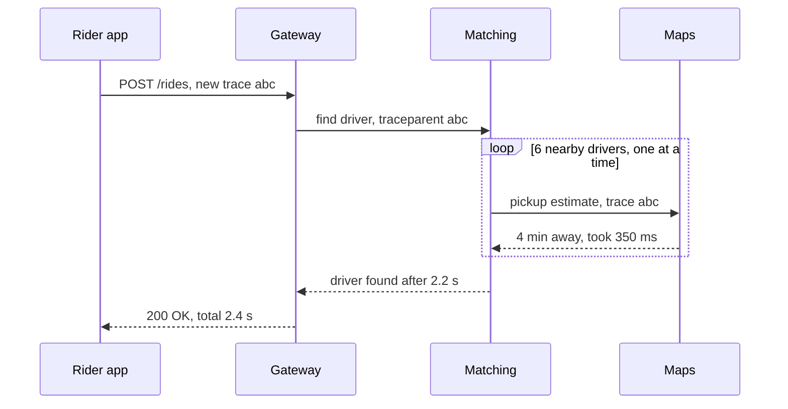

# Distributed Tracing

> Distributed tracing follows one request as it hops across all your services and records how long each hop took. When a request is slow, it shows you exactly where the time went.

## How it works

When a request enters your system, the first service gives it a trace ID. Every service it touches records one or more spans. A span is one unit of work, like "query the database" or "call pricing", with a start time, a duration, the trace ID, and the ID of the span that called it. The tracing backend gathers every span with the same trace ID and draws a waterfall: a timeline showing which calls ran in order, which ran in parallel, and which one ate the time.

The glue is context propagation. Each service passes the trace ID to the next, usually in a `traceparent` HTTP header, which is a W3C standard. That includes message queues: the ID has to ride inside the message so the service reading it can continue the trace.

Many teams use OpenTelemetry, an open source standard and set of libraries for emitting traces, metrics, and logs. It instruments common web frameworks, HTTP clients, and database drivers for you, and sends data to the backend you pick, like Jaeger, Grafana Tempo, Honeycomb, or Datadog. Switching vendors doesn't mean rewriting your code.

Tracing every request gets expensive, so you sample. Keeping 1 percent at random is simple. Tail sampling is smarter: decide after the request finishes, and always keep the errors and the slow ones.

Watch out: one service that doesn't forward the header splits every trace that passes through it in two. You get two half traces, and the slow part sits in the half you can't connect to the rest.

## Example

A ride sharing app's "request a ride" call takes 2.4 seconds for its slowest 1 percent of requests, and every service team swears theirs is fast. On average, each of them is right.

The waterfall for one slow trace settles it. The gateway takes 10 ms, pricing 80 ms, and driver matching 2.2 seconds. Inside matching, there are 6 calls to the maps service, one after another, about 350 ms each, one per nearby driver to estimate pickup time.

The matching team switches to a single batch call that asks for all 6 estimates at once. That call takes 380 ms, and the slow end of "request a ride" drops to about 700 ms. Nobody had to guess, and no team had to defend its dashboard.

## Picture it

Every message carries the same trace ID, so the backend can line up the spans into one timeline. The loop is the problem: six maps calls in a row, each one waiting for the last.

## Related

[Observability](observability.md) · [Logging](logging.md) · [Latency](../01-performance/latency.md) · [Service Mesh](../15-architecture/service-mesh.md) · [Monolith vs Microservices](../15-architecture/monolith-vs-microservices.md)

---

[← Metrics](metrics.md) · [All concepts](../../README.md) · [Monitoring →](monitoring.md)
