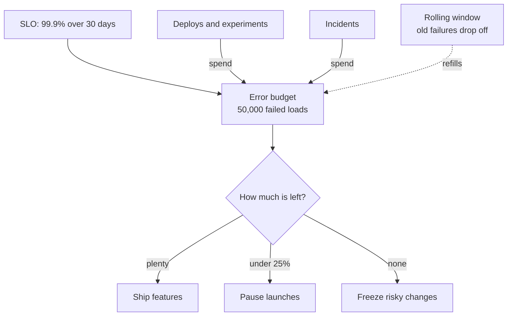

# Error Budgets

> An error budget is the amount of failure your SLO allows: 100 percent minus the target. While budget is left you ship fast, and when it runs out, risky changes stop until reliability recovers.

## How it works

If your SLO is 99.9 percent over 30 days, your error budget is the other 0.1 percent. That's about 43 minutes of full downtime, or 1 failed request in every 1,000. With 10 million requests a month, you can afford 10,000 failures.

The budget turns reliability into something you spend. Every bad deploy, every risky migration, every experiment that goes wrong takes a bite. Spending it is the point. A team that never touches its budget is probably moving too slowly.

The rules live in an error budget policy that engineering and product agree on ahead of time:

- **Budget healthy.** Ship features, run experiments, do the scary database migration.
- **Budget burning fast.** Slow down releases and use canary releases, which ship to a small slice of users first.
- **Budget gone.** Freeze risky changes. Only fixes and reliability work ship until old failures roll out of the window and the budget recovers.

Burn rate is how fast you're spending. A burn rate of 1 uses up the budget exactly at the end of the window. A burn rate of 14 eats a month's budget in about two days, which is worth waking someone for.

The catch: the policy only works if it was agreed before the budget ran out. Made up in the middle of a bad month, a freeze becomes a fight between the people who want to ship and the people tired of being paged, and the launch usually wins.

## Example

A social feed has an SLO of 99.9 percent of feed loads succeeding over a rolling 30 days. With 50 million loads a month, the budget is 50,000 failed loads.

In week one, a bad deploy fails 30,000 loads before it is rolled back. In week two, a database migration fails another 15,000. That leaves 5,000, or 10 percent of the budget.

The policy says launches pause when less than 25 percent is left. The new ranking algorithm waits, and the team spends the time adding automatic rollbacks to the deploy pipeline. Once the bad days from week one slide out of the 30 day window, most of the budget comes back, and the launch goes out to 5 percent of users first.

## Picture it

The SLO sets the size of the budget, and deploys and incidents draw it down. How much is left decides what the team is allowed to do next.

## Related

[SLOs](slos.md) · [SLIs](slis.md) · [Canary Releases](../20-releases/canary-releases.md) · [Feature Flags](../20-releases/feature-flags.md) · [Alerts](alerts.md)

---

[← SLAs](slas.md) · [All concepts](../../README.md) · [CI/CD →](../19-build-and-infra/ci-cd.md)
