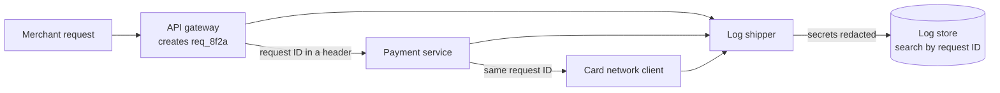

# Logging

> Logs are the timestamped record of what your code did, one event per line. Done well, they let you rebuild exactly what happened to one request, at 3 AM, across ten services.

## How it works

Write structured logs: JSON with named fields instead of free text. A line like "payment failed for user 42" is hard to search. `{"event":"payment_failed","user_id":42}` can be filtered, counted, and grouped by any field.

Give every line a level so you can filter out the noise:

- **DEBUG.** Fine detail for developers. Usually off in production.
- **INFO.** Normal events worth keeping, like "order placed".
- **WARN.** Something odd that the code recovered from, like a retry.
- **ERROR.** Something failed and a person may need to look.

Then add a request ID. The first service that sees a request generates a unique ID, passes it to every downstream service in a header, and every log line includes it. Now one search pulls the full story of one request across every service. Without it, you're lining up timestamps from 40 servers by hand.

Watch the volume. Log platforms usually charge per gigabyte ingested, and one chatty DEBUG line inside a loop that runs thousands of times a second can cost more than the servers it runs on. Sample the noisy stuff, keep errors in full, and set retention (how long you keep logs), like 30 days searchable and a year in cheap storage.

The catch: never log secrets. Passwords, tokens, card numbers, and full `Authorization` headers end up in logs because someone dumped the whole request "just for debugging". Your log store is read by far more people than your database, and it's kept for months. Mask them in the logging library itself, instead of hoping everyone remembers.

## Example

A merchant writes in: "A payment failed around 14:03, and the customer was charged anyway." Before structured logs, the team greps plain text lines like "Payment error" across 40 servers and three services. It takes an afternoon.

After, the API returns a request ID with every response, so the merchant includes it in the ticket. One query pulls 14 lines from the gateway, the payment service, and the card network client, in order. The one that matters:

```json
{"ts":"14:03:42.481Z","level":"error","service":"payments",
 "request_id":"req_8f2a","merchant_id":"m_1042",
 "event":"card_capture_timeout","duration_ms":30000}
```

The capture call timed out after 30 seconds, but the card network had already approved it. Ten minutes to the root cause. And notice what isn't in the line: no card number, no API key.

## Picture it



The gateway stamps each request with an ID, and every service copies it into its own log lines. One search for `req_8f2a` returns the whole story, already stripped of secrets.

## Related

[Observability](observability.md) · [Distributed Tracing](distributed-tracing.md) · [Metrics](metrics.md) · [Secrets Management](../16-identity-and-encryption/secrets-management.md) · [Cost Optimization](../22-operations/cost-optimization.md)

---

[← Observability](observability.md) · [All concepts](../../README.md) · [Metrics →](metrics.md)
