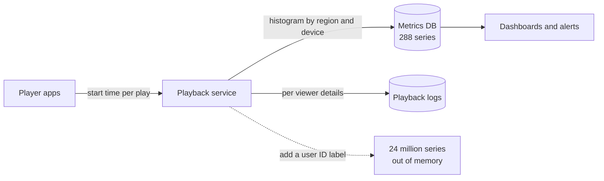

# Metrics

> Metrics are numbers your system records over time, like requests per second or memory in use. They're cheap to store and fast to graph, as long as you don't tag them with the wrong labels.

## How it works

A metric is a name, a number, and a timestamp, usually collected every 10 to 60 seconds. Each data point is tiny, so you can keep a year of them for little money and graph them instantly. Three types cover almost everything:

- **Counter.** A number that only goes up, like total requests served, until a restart resets it to zero. You graph its rate: requests per second.
- **Gauge.** A number that goes up and down, like queue depth or memory in use. You graph its current value.
- **Histogram.** Values sorted into buckets, like "how many requests took under 100 ms, under 250 ms, under 1 s". This is how you get p99 latency, the time 99 out of 100 requests finish within, which averages hide.

Labels add dimensions: `http_requests_total{route="/checkout", status="500"}`. Now one metric can show errors per route or per status code.

Here's the trap. Every unique combination of label values becomes its own time series, a separate line the metrics database has to store and index. 20 routes times 5 status codes is 100 series. Fine. Add a `user_id` label and you get a series per user. With 2 million users, that's at least 2 million series for one metric, and your Prometheus server (a popular open source metrics database) runs out of memory, or your vendor bill explodes. This is the cardinality trap: too many distinct values.

Watch out: labels are only for things with a small, fixed set of values, like region, route, or status code. User IDs, order IDs, and request IDs belong in logs and traces.

## Example

A video streaming site measures how long videos take to start with a histogram called `video_start_seconds`, labeled by region and device type. That's 6 regions times 4 device types times 12 series per histogram (10 buckets plus a sum and a count): 288 series. Cheap and fast.

A product manager wants slow starts per viewer, so someone adds a `user_id` label. With 2 million active viewers, the same metric becomes 24 million series. Within a day the metrics cluster is out of memory, and every dashboard in the company times out, including the ones on call depends on.

They roll the label back. Per viewer start times go into the playback logs instead, which are built for looking up one user, and the histogram goes back to 288 series.

## Picture it

The same measurement goes to two places. Small, fixed labels go to the metrics database, and per viewer detail goes to logs. The dotted path is the one label that would have taken the whole metrics system down.

## Related

[Monitoring](monitoring.md) · [P99 Latency](../01-performance/p99-latency.md) · [Logging](logging.md) · [Distributed Tracing](distributed-tracing.md)

---

[← Logging](logging.md) · [All concepts](../../README.md) · [Distributed Tracing →](distributed-tracing.md)
