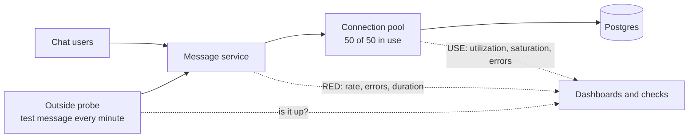

# Monitoring

> Monitoring is watching your system for the failures you already know can happen, using dashboards and automatic checks. It tells you something broke, fast, so you aren't the last to find out.

## How it works

You decide in advance what healthy looks like, collect the numbers, put them on dashboards, and set checks that fire when a number crosses a line. Monitoring answers known questions: is the site up, is the error rate normal, is the disk filling up.

Three tools keep you from staring at 200 random graphs:

- **RED, for services.** Rate (requests per second), Errors (failed requests per second), and Duration (how long requests take, as percentiles). Every API and web service gets these three.
- **USE, for resources.** Utilization (how busy it is), Saturation (how much work is waiting), and Errors. Apply it to CPU, memory, disks, network, and connection pools. Brendan Gregg came up with this one.
- **Synthetic checks.** A robot that loads the homepage or logs in every minute from 3 regions, so you catch an outage even when no real traffic is flowing.

RED tells you users are hurting. USE often tells you why. A slow service sitting on a full connection pool, with requests queued up waiting for it, is a short investigation.

This covers the failures you can name in advance. For the strange new ones, you need observability: data rich enough to answer questions no dashboard was built for.

The catch: don't run your monitoring on the same cluster or in the same region it watches. When that region goes down, the monitoring goes with it, and the silence looks exactly like a quiet night. Keep at least one probe outside, watching the watcher.

## Example

A chat app's message service has a RED dashboard. One evening, rate is normal at 8,000 messages per second and errors sit at 0.1 percent, but p99 duration (the time 99 out of 100 sends finish within) climbs from 120 ms to 900 ms. Users watch messages hang on "sending".

The USE panels for the database answer it in a minute. CPU is at 35 percent, so the database itself is fine. The connection pool is not: all 50 connections in use, and 300 requests waiting in line for one. A new feature had started holding a connection open while it called another service. The team rolls it back, and the pool drops to 20 in use. Next day they add a check on pool saturation.

## Picture it

RED numbers come from the service, USE numbers come from the resources under it, and an outside probe checks the whole path. Slow RED plus a saturated pool points straight at the cause.

## Related

[Observability](observability.md) · [Metrics](metrics.md) · [Alerts](alerts.md) · [Health Checks](../14-reliability/health-checks.md) · [SLIs](slis.md)
